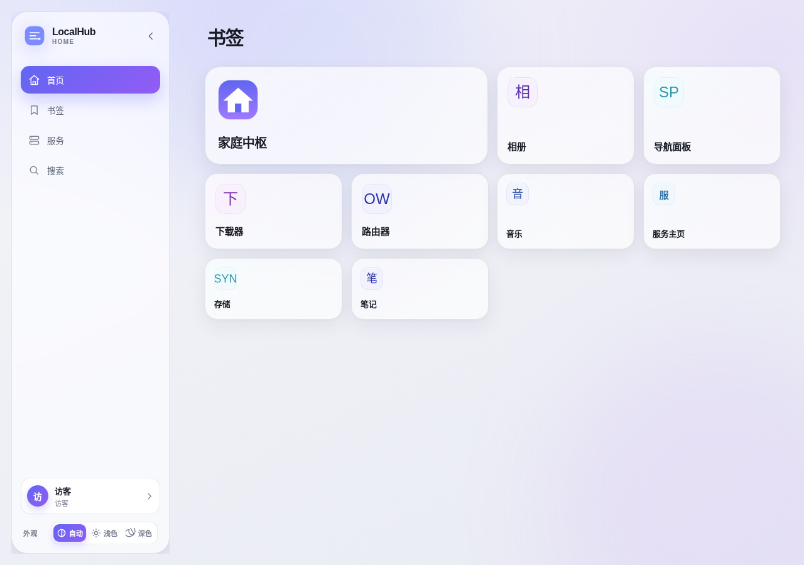
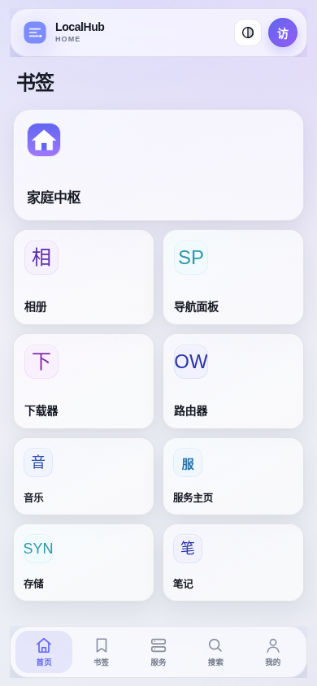
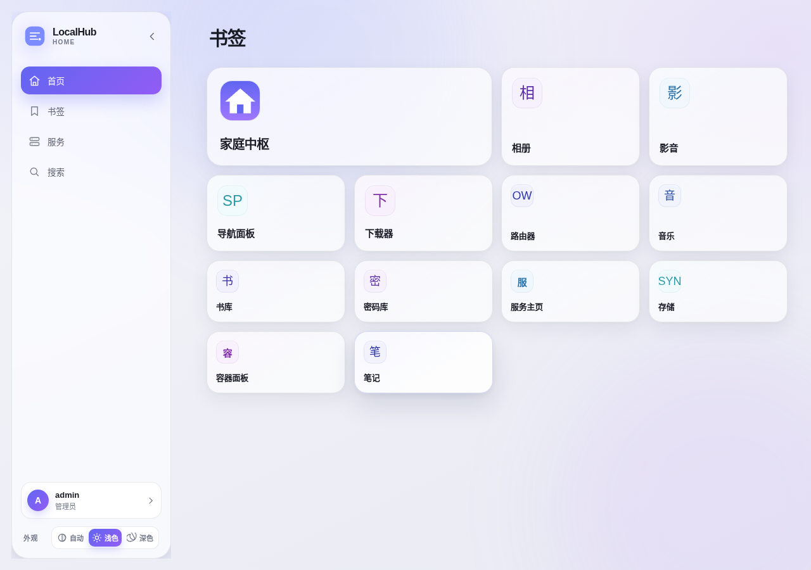
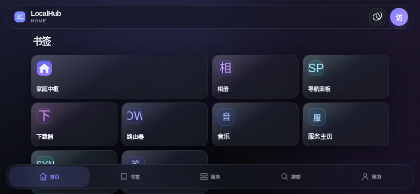

# LocalHub P3.1 实施报告

- 批次：P3.1 — Homepage Foundation & Bookmark Display
- 日期：2026-11-28
- 代码仓库：`laoXuHome/LocalHub`，`main`
- 功能 Commit：`d5019533f029f781c3378f7a60af2249103cb83f`
- 基线 Commit：`6881e309076815ef251213376eb1a130137424ff`（P2.3-R1 文档汇总）
- 实施状态：代码、构建、真实数据浏览器验收、CI 三 Job、amd64/arm64 镜像与 T12 均已完成

> 验收状态说明：P0、P1.1、P2.1、P2.2、P2.3、P2.3-R1 均已在仓库中实施，其中 P2.2、P2.3、P2.3-R1 的正式验收结论仍以项目负责人记录为准。本报告将上述批次作为“已实施基线”进行回归，不把历史批次改写为“已验收通过”。

## 1. 本批结论

P3.1 交付了一个可运行的 LocalHub 首页：

- 桌面端为 macOS 风格应用外壳，包含可折叠侧边栏、主内容区、毛玻璃、柔和阴影、大圆角与蓝紫强调色。
- 移动端为顶部悬浮栏、底部五项导航，断点覆盖手机竖屏与横屏，不产生横向溢出。
- 首页唯一主体是真实书签：标题和图标来自 `GET /api/bookmarks`，点击按后端给出的 URL 打开。
- 已实现 AUTO、LIGHT、DARK 三种主题，选择持久化，AUTO 响应系统外观变化。
- 已实现加载骨架、空状态、加载失败重试、Toast、页面进入过渡，并尊重 `prefers-reduced-motion`。
- 未增加书签编辑、拖拽排序、管理后台、Docker、Backup、Settings 或 P3.2 的任何功能。
- 未在前端硬编码书签、演示数据或 mock 数据。

## 2. 施工范围与边界

### 2.1 已完成范围

1. 应用 shell：桌面侧边栏 + 主内容区；移动顶栏 + 底部五项导航。
2. 首页书签展示：真实 API、真实图标、真实排序、点击跳转、权限可见性。
3. 响应式卡片：首张 large、第 2–5 张 medium、其余 small；网格随视口自适应。
4. 主题系统：AUTO / LIGHT / DARK + `localhub.theme` 持久化 + 系统外观监听。
5. 基础交互：加载、空、失败、Toast、过渡、减少动态效果。
6. 账户入口：保留 P1.1 的管理员登录、改密、退出能力，收纳进账户 Sheet。
7. 自动化测试：18 条纯函数单元测试；CI web job 增加 `npm test`。
8. 验收截图：16 张，覆盖桌面/移动、窄窗/横屏、三主题、访客/管理员、空/加载失败/骨架屏。

### 2.2 明确未做（符合任务书禁止事项）

- 未做书签编辑模式、添加/删除/改名/改 URL、拖拽排序、缩放。
- 未做撤销、重做、预览、手动保存。
- 未做书签管理后台。
- 未做 Docker 管理页面、Backup 页面、Settings 页面。
- 未引入演示数据、前端 mock 或虚构书签。
- 未修改 P0、P1.1、P2.1、P2.2、P2.3 的后端业务逻辑与已验收接口。
- 未启动 P3.2。

## 3. 实现说明

### 3.1 真实数据与权限

首页同时请求：

- `GET /api/auth/status`：得到当前角色与账户状态。
- `GET /api/bookmarks`：得到后端已按权限过滤、已过滤禁用项、已按排序返回的书签。

前端不做二次权限判断、不重排、不补数据。访客、管理员、禁用书签的可见性完全沿用后端规则，避免前端与后端出现两套权限口径。

### 3.2 书签卡片

每张卡片只渲染：

1. 图标：文件图标、文字/emoji 图标、名称首字母兜底。
2. 名称。

首页不显示 URL 文本、描述、访问次数、更新时间、Docker 状态或其它辅助信息。

图标优先级：

- `has_icon + icon_url`：使用 P2.2 的图标接口。
- `icon_type=url/favicon`：使用合法的 HTTP(S) 图标 URL。
- `icon_type=emoji/text`：渲染文字/emoji。
- 其余：名称首字。

卡片链接只接受 `http:` / `https:`；无合法 URL 的书签降级为不可点击卡片。新标签打开时补充 `noopener noreferrer`。

### 3.3 布局与响应式

- 桌面（`>900px`）：左侧 252px 侧边栏，可收至 76px；折叠状态写入 `localhub.sidebar`。
- 移动（`≤900px`）：隐藏侧边栏，显示顶部悬浮栏和底部五项导航。
- 书签网格：CSS Grid 自适应列数；1440/1280 桌面为 3 列、960 窄窗为 3 列、390 竖屏为 2 列、844 横屏为 4 列紧凑网格。
- 横屏单独增加 `grid-auto-rows: 88px` 与卡片尺寸覆盖，避免卡片高度覆盖造成的重叠。
- 320、390、844、960、1280 五种宽度实测 `document.documentElement.scrollWidth === innerWidth`，无横向溢出。

### 3.4 主题系统

- `localhub.theme` 保存 `auto | light | dark`。
- `AUTO` 使用 `matchMedia('(prefers-color-scheme: dark)')`，并监听变化。
- 首屏在 React 挂载前由 `index.html` 内联脚本预置主题，减少刷新闪白。
- 桌面为三段式控件；移动为单按钮循环，并在账户/顶栏保留当前状态。
- 三种模式均通过实际点击和 CDP 系统外观模拟验证。

### 3.5 状态与交互

- 加载：8 张骨架卡，带 `aria-busy`。
- 空：管理员“书签库还是空的”，访客“暂时没有公开书签”。
- 失败：错误卡片 + 重新加载按钮 + Toast；同时处理 503 和网络失败。
- Toast：登录成功、退出、导航占位等；3.2 秒自动消失，可手动关闭。
- 过渡：卡片/状态/Toast/Sheet 入场动画。
- `prefers-reduced-motion: reduce` 下动画时长降为 `0.01ms`，迭代 1 次。
- 非首页导航：保持当前首页，仅提示“将在后续批次开放”，不伪造业务页面。

### 3.6 账户 Sheet

保留 P1.1 行为：管理员可登录、修改密码、退出；访客可登录。移动端与桌面端共用同一 Sheet；打开时锁定 body 滚动。登录/退出后重新拉取权限书签并刷新角色。

## 4. 修改文件

### 4.1 新增

| 文件 | 作用 |
| --- | --- |
| `web/src/types.ts` | 前端 API 类型、主题类型 |
| `web/src/lib.ts` | 主题、URL、图标、卡片尺寸等纯函数 |
| `web/src/lib.test.ts` | 18 条纯函数单元测试 |
| `web/src/api.ts` | 书签/认证 API 客户端 |
| `web/src/theme.ts` | 主题读取、应用、持久化、系统监听 |
| `web/src/components/Icons.tsx` | 内联 SVG 图标与品牌标识 |
| `web/src/components/BookmarkCard.tsx` | 书签卡片 |
| `web/src/components/Toast.tsx` | Toast |
| `web/src/components/ThemeSwitcher.tsx` | 三段/紧凑主题控件 |
| `web/src/components/AccountSheet.tsx` | 登录/改密/退出 Sheet |
| `docs/p3.1/*.png` | 16 张真实运行截图 |
| `docs/p3.1-report.md` | 本报告 |

### 4.2 修改

| 文件 | 作用 |
| --- | --- |
| `web/src/App.tsx` | 重写为 P3.1 应用 shell 与首页 |
| `web/src/style.css` | 重写主题 token、布局、卡片、状态、Sheet、响应式 |
| `web/index.html` | 标题、viewport-fit、theme-color、首屏主题脚本 |
| `web/vite.config.ts` | 本地 `/api`、`/health` 代理；关闭 `changeOrigin` 修复 CSRF |
| `web/package.json` | 增加 `test` 脚本与 `vitest` |
| `web/package-lock.json` | 锁定测试依赖 |
| `.github/workflows/ci.yml` | web job 增加 `npm test` |

### 4.3 未修改

- 未修改 `cmd/`、`internal/` 内任何 Go 文件。
- 未修改数据库 schema、迁移、认证、权限、图标、导入导出逻辑。
- 未修改 `Dockerfile`（其已有 `web build → internal/static/dist` 流程）。

## 5. 真实数据与浏览器验收

### 5.1 运行环境

- 临时数据目录：`/tmp/localhub-p31`
- Go 服务：`127.0.0.1:11030`，`schema_version=5`
- 前端：Vite `127.0.0.1:5173`，`/api` 代理到 11030
- 浏览器：Chromium（Browser Use CDP）

所有截图均来自真实 API 返回；测试书签通过管理 API 写入临时数据库，不是前端写死。

### 5.2 数据与权限结果

- 管理员接口返回 13 条启用书签，顺序 `id=1..13`，`sort_order=1..13`。
- 访客接口返回 9 条：`家庭中枢、相册、导航面板、下载器、路由器、音乐、服务主页、存储、笔记`。
- `authenticated` / `private` 书签 `影音、书库、密码库、容器面板` 仅管理员可见。
- 第 14 条 `Docker Registry` 在数据库为禁用；访客和管理员列表均不出现。
- 访客与管理员均未返回 `enabled=false` 项。
- 恢复禁用状态后，管理员仍 13 条、访客仍 9 条，证明测试过程未破坏数据。

### 5.3 点击与跳转

- 第一张“家庭中枢” DOM：`href=http://192.168.1.10:8123/`，`target=_blank`。
- 实际点击后新标签页 URL 变为 `http://192.168.1.10:8123/`，随后关闭该标签页，原首页未丢失。
- 无合法 URL 的书签会渲染为不可点击卡片；当前验收数据中没有此类可见项。

### 5.4 主题结果

| 操作 | 结果 |
| --- | --- |
| 桌面点击 `自动` | `localStorage=auto`，当前浅色 |
| 桌面点击 `浅色` | `localStorage=light`，`data-theme=light` |
| 桌面点击 `深色` | `localStorage=dark`，`data-theme=dark` |
| 移动紧凑按钮循环 | `dark → auto → light → dark`，值同步 |
| AUTO + 模拟系统深色 | `data-theme=dark` |
| AUTO + 模拟系统浅色 | `data-theme=light` |
| 清除系统模拟 | 恢复真实系统外观 |
| 深色后刷新 | 仍为 `dark`，管理员会话与 13 条数据保留 |
| 刷新后移动 390×844 | 仍为 `dark`，13 条数据 |

### 5.5 响应式与交互状态

- 侧边栏折叠：252px → 76px，`localhub.sidebar=collapsed`；展开后回到 252px。
- 844×390：侧边栏隐藏、顶栏显示、底部导航显示。
- 960×780：侧边栏显示、顶栏/底栏隐藏。
- 320/390/844/960/1280：均无横向溢出。
- 减少动态效果：卡片动画 `0.42s → 1e-05s`，迭代次数 `1`。
- 服务导航占位：显示 Toast“「服务」将在后续批次开放”，首页保持激活。
- 空状态：管理员/访客各有对应文案，0 张卡片。
- 加载骨架：延迟 fetch 时显示 8 张骨架卡。
- 加载失败：停止 Go 服务后显示“无法加载书签”、重试按钮与错误 Toast；重启后恢复 9 条。

## 6. 截图清单

截图位于 `docs/p3.1/`，均为实际运行截图。

| 文件 | 视口 | 角色/主题 | 内容 |
| --- | --- | --- | --- |
| `desktop-guest-auto.png` | 1280×900 | 访客 / AUTO 浅色 | 正常桌面窗口，9 张卡 |
| `desktop-guest-light.png` | 1280×900 | 访客 / LIGHT | 浅色桌面 |
| `desktop-guest-dark.png` | 1280×900 | 访客 / DARK | 深色桌面 |
| `desktop-narrow-light.png` | 960×780 | 访客 / LIGHT | 桌面窄窗，3 列 |
| `desktop-guest-collapsed-dark.png` | 1280×900 | 访客 / DARK | 侧边栏折叠 76px |
| `desktop-admin-light.png` | 1280×900 | 管理员 / LIGHT | 13 条，含 authenticated/private |
| `desktop-admin-toast.png` | 1280×900 | 管理员 / AUTO 浅色 | 登录成功 Toast“已登录，私有书签已显示” |
| `desktop-account-admin.png` | 1280×900 | 管理员 / LIGHT | 账户 Sheet |
| `mobile-guest-auto.png` | 390×844 | 访客 / AUTO 浅色 | 竖屏，2 列 |
| `mobile-landscape-dark.png` | 844×390 | 访客 / DARK | 横屏，4 列 |
| `mobile-admin-dark.png` | 390×844 | 管理员 / DARK | 13 条 |
| `mobile-admin-auto-system-dark.png` | 390×844 | 管理员 / AUTO + 系统深色 | AUTO 响应系统 |
| `mobile-guest-loading-dark.png` | 390×844 | 访客 / DARK | 加载骨架 |
| `mobile-admin-empty-dark.png` | 390×844 | 管理员 / DARK | 管理员空状态 |
| `mobile-guest-empty-dark.png` | 390×844 | 访客 / DARK | 访客空状态 |
| `mobile-guest-error-dark.png` | 390×844 | 访客 / DARK | 后端停止时的失败状态与 Toast |

### 关键截图

桌面访客 AUTO 浅色：



移动访客 AUTO 浅色：



桌面管理员 LIGHT：



移动横屏 DARK：



## 7. 自动化测试与回归

### 7.1 前端

- `npm test`：`vitest run`，1 个测试文件，18/18 通过。
- 覆盖：主题顺序/解析、URL 协议校验、书签 href/target、图标类型/来源/文字、首字母、卡片尺寸、色相稳定性。
- `npm run build`：`tsc --noEmit && vite build` 成功。
- 产物：`dist/index.html` 1.34 kB、CSS 24.08 kB、JS 160.90 kB。
- 干净安装验证：临时目录执行 `npm ci` → `npm test` → `npm run build`，均通过，证明锁文件可用于 CI。
- CI 已在 `.github/workflows/ci.yml` 的 web job 增加 `npm test`。

### 7.2 Go 全量回归

执行 `go test ./... -count=1`，9 个有测试的包全部通过；共 78 个 Go 测试函数。

```text
ok  internal/approle       15.089s
ok  internal/auth          2.491s
ok  internal/bookmark      0.100s
ok  internal/config        0.012s
ok  internal/datadir       0.018s
ok  internal/db            0.069s
ok  internal/favicon       0.107s
ok  internal/icon          0.023s
ok  internal/transfer      0.109s
```

该回归覆盖 P0 初始化、P1.1 认证、P2.1 书签、P2.2 图标、P2.3/R1 导入导出与文件夹层级等既有测试。

### 7.3 兼容性结论

- 无文件夹书签在本次真实数据中正常展示；导入导出接口未改动。
- 数据迁移：本批没有新增迁移；临时库 `schema_version=5` 与 P2.3-R1 一致。
- 权限、图标、重复检测：后端逻辑未改，Go 测试通过；浏览器实测管理员 13 / 访客 9。
- 未发现 P0、P1.1、P2.1、P2.2、P2.3 的接口行为变化。

## 8. CI 与多架构

### 8.1 CI 三 Job

- CI Run：[46035230945](https://github.com/laoXuHome/LocalHub/actions/runs/46035230945)
- Head SHA：`d5019533f029f781c3378f7a60af2249103cb83f`
- 总体结果：`success`（run #26，2026-11-27T16:37:52Z → 2026-11-27T16:44:03Z）
- Artifact：`verification-d5019533f029f781c3378f7a60af2249103cb83f`，ID `15217140492`

| Job | 结果 | 关键内容 |
| --- | --- | --- |
| 前端构建 | success | `npm ci` → `npm test`（18/18）→ `tsc --noEmit && vite build` |
| Go 质量与测试 | success | `gofmt`、`go vet`、`go test ./...`、静态编译 |
| 多架构镜像与 T12 验证 | success | amd64/arm64 构建、T12 全通过、arm64 QEMU 运行、Compose 冒烟与 P2.3 导入导出 |

前端 Job 日志确认：

```text
Test Files  1 passed (1)
     Tests  18 passed (18)
✓ built in 537ms
```

### 8.2 amd64 / arm64

| 架构 | 镜像结果 | 版本信息 |
| --- | --- | --- |
| linux/amd64 | `localhub:amd64`，image `48a8cb61b510`，22 MB | `localhub v0.1.0-p0 commit=d5019533… build_time=2026-11-27T16:38:45Z` |
| linux/arm64 | `localhub:arm64`，image `c1070fed7d8f`，5.19 MB | `localhub v0.1.0-p0 commit=d5019533… build_time=2026-11-27T16:39:23Z` |

- T12（amd64）：`RESULT: ALL PASS`，覆盖 `--version`、distroless 无 shell、健康检查、数据目录属主、非 root、能力缺失、SIGTERM/SIGINT、降级、PUID 自检、路径逃逸、重建后数据保持；`schema_version=5`。
- arm64（QEMU）：`/health HTTP 200`，容器 `exit_code=0`，健康响应为 `schema_version=5`、`uid=1000`、`is_root=false`。
- Compose（amd64）：`/health HTTP 200`；导入预览 `folder_path=["工作","项目"]`，执行 1 条，重启后仍为 `["工作","项目"]`；HTML 导出 HTTP 200；访客导出 HTTP 401。
- 该 Compose 冒烟同时证明 P2.2 图标、P2.3/R1 文件夹层级持久化与导出在新的 P3.1 镜像中没有退化。

## 9. 合规检查

- 首页无 URL 文本、描述、访问次数、更新时间、Docker 状态文字。
- 首页无演示/硬编码书签；空库时展示空状态。
- 未改后端已验收接口；未新增未经批准的业务页面。
- 未进入 P3.2；未开发编辑模式。
- 导航未实现的模块只给 Toast 占位，不伪装成可用功能。

## 10. 已知限制与未完成事项

1. **历史批次验收记录**：P2.2、P2.3、P2.3-R1 仍以项目负责人验收结论为准；本报告的“回归通过”只是代码与测试结果，不等同于历史批次正式验收。
2. **浏览器范围**：验收使用 Chromium 内核；未在 Safari / Firefox 实机验证。
3. **桌面最大宽度**：实际截图取 1280×900 与 960×780；未提供 1440 宽截图。
4. **移动主题入口**：移动端为单按钮循环（AUTO→LIGHT→DARK），不是三段展开；三种模式均可切换并持久化。
5. **截图环境的 emoji**：Chromium 运行环境缺少彩色 emoji 字体，部分测试数据用文字图标，首条保留真实 PNG 文件图标；产品代码支持 emoji/text/url/file 四种图标。
6. **空状态文案**：管理员空状态写“添加书签后……”，指的是通过既有管理 API/导入写入；本批未提供前端添加书签入口（任务书明确禁止）。
7. **设计基线**：仓库未提供独立的 UI/UX 基线文件，视觉按本批任务书中的 macOS/iOS 方向实现。
8. **镜像内 UI E2E**：本地截图使用 Vite dev + 真实 Go API；CI 已验证镜像构建、T12、arm64 运行与 API/Compose 冒烟，但未在容器内跑浏览器级首页 E2E；镜像内静态页由同一 `web/dist` 构建产物提供。

## 11. 停止状态

P3.1 完成后停止，不启动 P3.2，不开发书签编辑模式，等待项目负责人验收。
