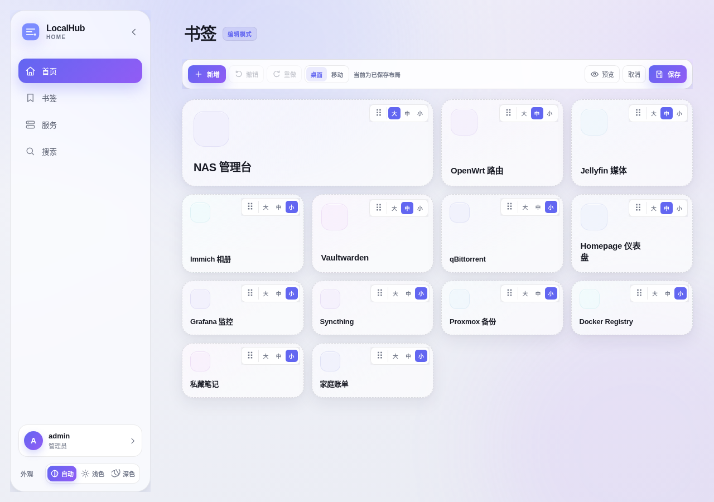
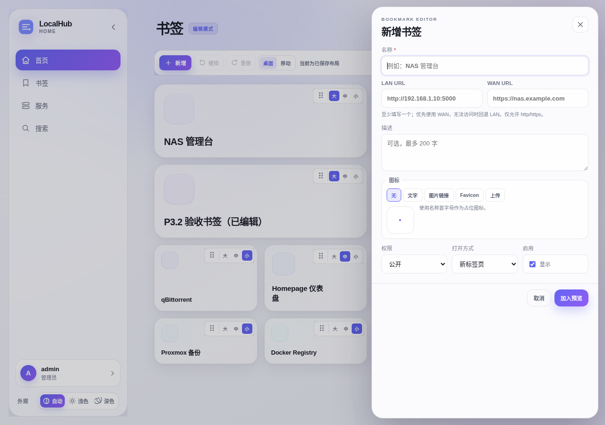
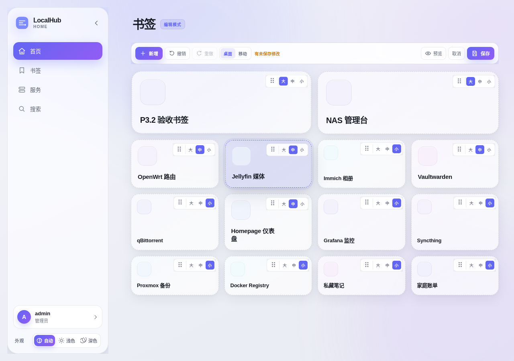
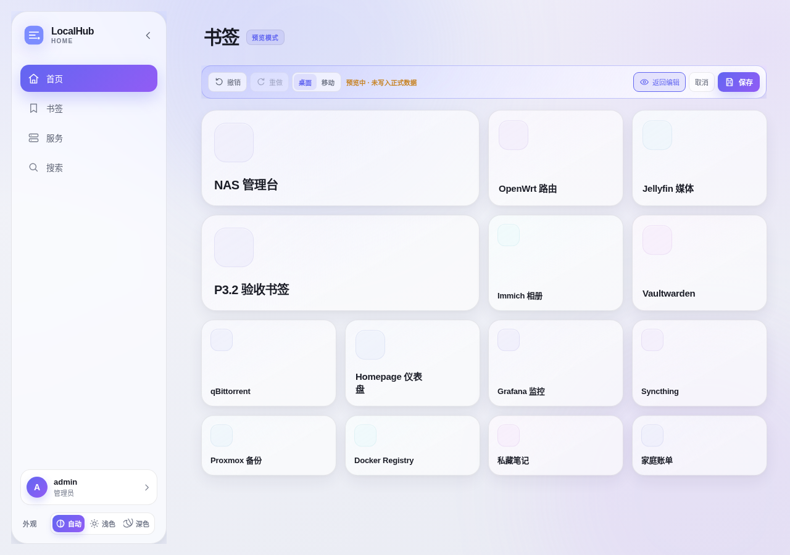
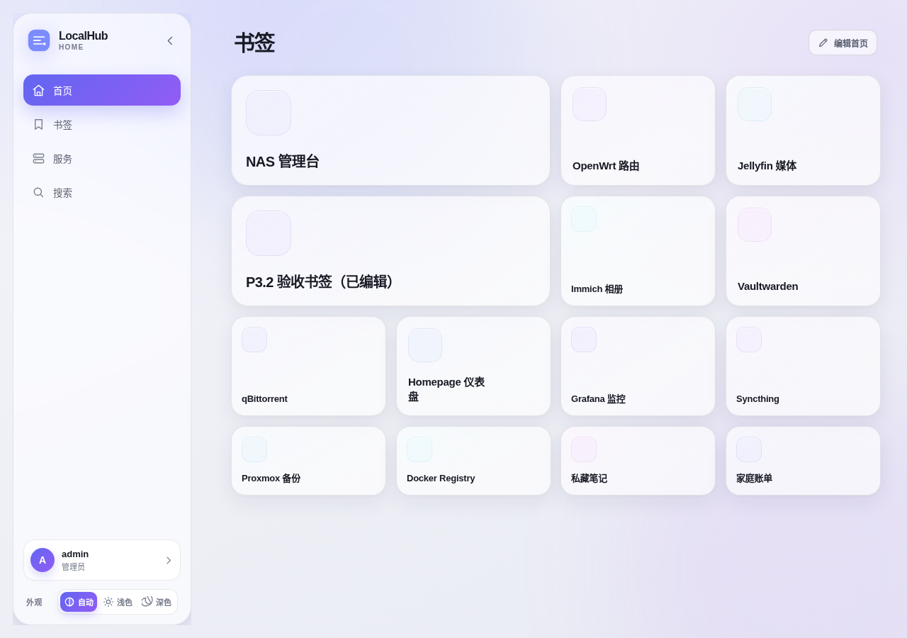
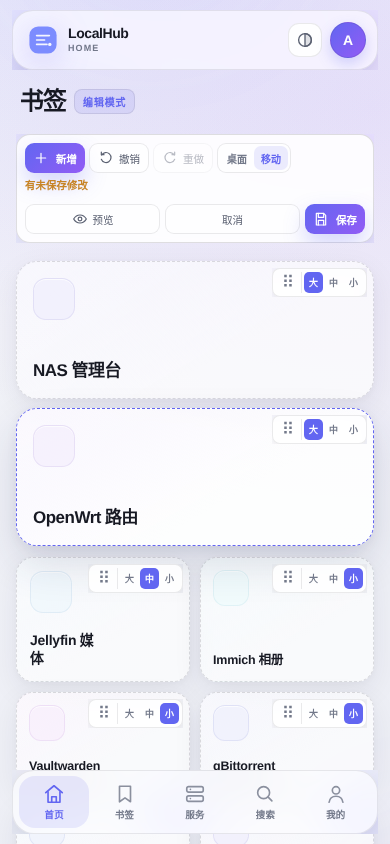
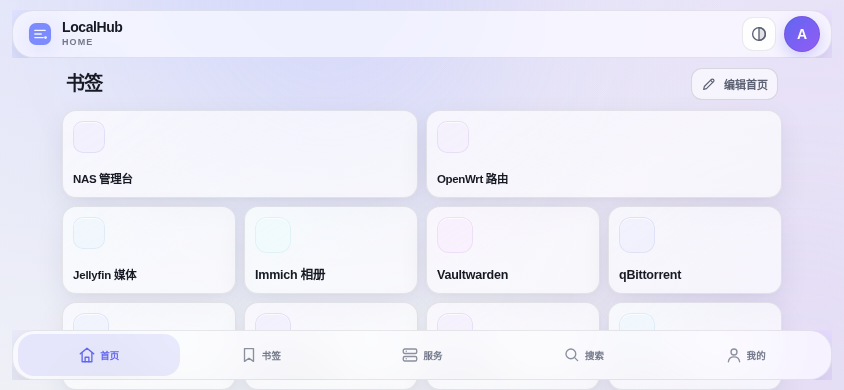

# LocalHub P3.2 实施报告

- 批次：P3.2 — Homepage Editing Mode & Bookmark Layout Management
- 日期：2026-11-28
- 代码仓库：`laoXuHome/LocalHub`，`main`
- 功能 Commit：`f3d460302fbc0de09e749a1677e44cb0bd5bd898`
- 父基线：`46ffc5e286ce0857804ecc7a210b10da3426ffd6`（P3.1 文档补录，P3.2 推送前远端 main）
- 实施状态：P3.2 范围内功能、真实数据浏览器验收、自动化测试、CI 三 Job、amd64/arm64 构建、T12 均已完成；未启动 P3.3。

> 基线口径：P3.2 建立在 P3.1 已实施首页上。P0、P1.1、P2.1、P2.2、P2.3、P2.3-R1 在仓库中已实施，历史批次正式验收结论仍以项目负责人记录为准；本报告将它们作为“已实施基线”做回归，不把历史批次改写为“已验收通过”。

## 1. 本批结论

P3.2 在 P3.1 首页上完成管理员专用编辑模式：

- 首页默认锁定；只有管理员可进入编辑，访客不渲染编辑入口；管理接口由后端 `requireAdmin` 保护。
- 统一右侧浮动 Drawer 新增/编辑书签；新增与编辑共用表单；支持名称、LAN URL、WAN URL、描述、图标、启用状态、权限类型、打开方式。
- 支持图标无/文字/图片链接/Favicon/上传五种来源；上传文件仅本地预览，保存时上传。
- 编辑现有书签提供删除入口，删除前二次确认；删除在保存时生效。
- 拖拽排序使用指针事件和 `data-key` 命中，拖动中有目标卡高亮，落点插入目标项之前。
- 卡片支持大/中/小三种尺寸；桌面与移动端各自维护布局。
- 撤销/重做覆盖新增、编辑、删除、拖动、尺寸调整。
- 预览只切换展示，不提前写正式数据；取消编辑/未保存离开会二次确认。
- 手动保存后书签与布局持久化；刷新页面仍保持；保存失败保留当前编辑内容并提示原因。
- 新增 SQLite 迁移 `0006_layout`，只新增 `bookmark_layouts`，不改 `bookmarks.sort_order`。

## 2. 施工范围与边界

### 2.1 已完成范围

| 能力 | 结果 |
| --- | --- |
| 编辑权限 | 管理员显示“编辑首页”，访客不显示；未登录 `PUT` 返回 401 |
| 新增书签 | Drawer 表单 → 草稿 → 保存到 `POST /api/admin/bookmarks` |
| 编辑书签 | 同一 Drawer；名称、URL、描述、图标、权限、打开方式、启用均更新 |
| 删除书签 | Drawer 删除入口 + 二次确认；保存时 `DELETE /api/admin/bookmarks/{id}`，并清理布局行 |
| 图标 | 无/文字/图片链接/Favicon/上传；文件 ≤256 KiB，保存时上传到现有图标接口 |
| 拖动排序 | 指针拖动、目标高亮、目标前插入、网格吸附；持久化到布局 |
| 卡片尺寸 | large / medium / small；当前设备独立修改；网格自动重排 |
| 布局存储 | `bookmark_layouts(device, bookmark_id, position, size)`；desktop/mobile 独立 |
| 撤销/重做 | 快照同时包含 drafts/layouts/deletedIDs；覆盖新增、编辑、删除、拖动、尺寸 |
| 预览 | 仅本地 UI，不调用写接口；工具栏提示“未写入正式数据” |
| 取消/离开 | 取消编辑未保存内容有确认；`beforeunload` 防止直接关闭丢失 |
| 手动保存 | 明确保存按钮；成功后重载书签和布局；失败保留编辑内容并提示 |
| 主题 | AUTO / LIGHT / DARK 下编辑工具栏、卡片、Drawer 均可读 |
| 响应式 | 桌面 1280×900、手机竖屏 390×844、手机横屏 844×390 均验证 |

### 2.2 明确未做（符合任务书禁止事项）

- 未开发 Docker 管理页面或 Docker 首页模块。
- 未开发 Backup、Settings 等业务页面。
- 未开发 LAN/WAN 自动探测。
- 未开发书签分类、标签、文件夹管理；沿用 P2.3-R1 已有 `folder_path` 数据，不新增文件夹编辑 UI。
- 未开发多用户、公开注册或新账户体系。
- 未修改 P0、P1.1、P2.1、P2.2、P2.3、P3.1 已验收接口语义；P3.2 只新增布局读取/保存接口，并在删除书签后清理布局。
- 未增加首页自定义模块、第三方扩展、前端硬编码书签或演示数据。
- 未启动 P3.3。

## 3. 实现说明

### 3.1 数据模型与迁移

新增 `internal/db/migrations/0006_layout.sql`：

```sql
CREATE TABLE IF NOT EXISTS bookmark_layouts (
    device       TEXT NOT NULL CHECK (device IN ('desktop', 'mobile')),
    bookmark_id  INTEGER NOT NULL,
    position     INTEGER NOT NULL,
    size         TEXT NOT NULL CHECK (size IN ('large', 'medium', 'small')),
    updated_at   TEXT NOT NULL,
    PRIMARY KEY (device, bookmark_id)
);
CREATE INDEX IF NOT EXISTS idx_bookmark_layouts_order ON bookmark_layouts(device, position);
```

约束：

- `bookmark_layouts` 只表达“设备 + 书签 + 位置 + 尺寸”，不替代 `bookmarks.sort_order`。
- 保存布局不写 `bookmarks.sort_order`；P2 排序数据保持原样。
- 删除单条/批量书签后调用 `DeleteForBookmark` 清理布局；清理失败只告警，不影响删除主流程。

### 3.2 后端接口

| 方法与路径 | 权限 | 语义 |
| --- | --- | --- |
| `GET /api/bookmarks/layout` | 访客/管理员 | 返回当前调用者可见书签的 desktop/mobile 布局；按现有书签可见性过滤，不泄露私有/禁用 ID |
| `PUT /api/admin/bookmarks/layout` | 管理员 | 必须同时提交 desktop/mobile 两个数组；严格 JSON；校验后原子替换两设备布局 |
| `POST /api/admin/bookmarks` | 管理员 | 沿用 P2 新增接口 |
| `PUT /api/admin/bookmarks/{id}` | 管理员 | 沿用 P2 更新接口 |
| `DELETE /api/admin/bookmarks/{id}` | 管理员 | 沿用 P2 删除接口，额外清理布局 |
| `PUT /api/admin/bookmarks/{id}/icon` | 管理员 | 沿用 P2.2 图标上传 |
| `POST /api/admin/bookmarks/{id}/favicon` | 管理员 | 沿用 P2.2 Favicon 抓取 |

布局校验：

- 每设备最多 200 项；ID 必须为正整数。
- `size` 仅 `large / medium / small`。
- 同设备内 ID 不重复。
- 写库前校验所有 ID 在 `bookmarks` 中存在。
- `ReplaceLayouts` 在事务中先删旧行、再写 desktop/mobile；中途失败回滚，不出现“只写一半”。

### 3.3 前端编辑模式

核心文件：

- `web/src/App.tsx`：认证、首页数据、编辑态、历史、拖动、设备切换、保存、预览、确认框。
- `web/src/editor.ts`：布局纯函数，负责草稿、排序、尺寸、payload、缺失 ID 过滤。
- `web/src/components/EditToolbar.tsx`：新增、撤销、重做、设备切换、预览、取消、保存。
- `web/src/components/BookmarkDrawer.tsx`：新增/编辑共用右侧 Drawer。
- `web/src/components/BookmarkCard.tsx`：编辑态拖拽手柄、尺寸按钮、目标高亮。
- `web/src/components/ConfirmDialog.tsx`：删除/放弃未保存的二次确认。
- `web/src/api.ts`：布局读取/保存、书签 CRUD、图标上传、Favicon。
- `web/src/style.css`：编辑工具栏、虚线编辑卡片、拖拽高亮、Drawer、表单、确认框、响应式。

编辑状态：

- 进入编辑：由 `buildLayouts(drafts, serverLayouts)` 生成初始快照。
- 历史快照同时保存 `drafts / layouts / deletedIDs`；撤销、重做恢复完整状态，覆盖新增、编辑、删除、拖动、尺寸。
- 只有当前设备布局被尺寸按钮修改；新增同时插入 desktop/mobile 末尾；删除从两布局移除并记录待删除 ID。
- 预览只切换渲染模式，不调用写接口；卡片恢复普通首页样式，但保留工具栏与保存能力。
- 取消编辑若有历史操作，先弹“放弃未保存修改？”；确认后才清空并退出。
- `beforeunload` 在未保存时触发浏览器原生离开确认。

### 3.4 保存流程

1. 对每个有变化的草稿依次 `create` / `update`。
2. 新创建 ID 记入 `createdIDsRef`，部分失败后重试不会重复创建。
3. 上传本次选择的本地图标；Favicon 保存时显式补抓，失败不阻断其他字段。
4. 删除 `pendingDeleted`，404 视为已删除。
5. `saveLayout` 提交当前 desktop/mobile 布局。
6. 重新 `loadBookmarks + loadLayout`，退出编辑并 Toast。
7. 保存失败：保留编辑态与全部草稿，Toast 显示“保存失败：… 当前编辑内容已保留，可重试”。

保存流程不是单事务批量接口，属于已知限制，见第 7 节。

## 4. 修改文件

功能提交统计：44 个文件，+2676 / -39。

### 4.1 新增

| 文件 | 作用 |
| --- | --- |
| `internal/db/migrations/0006_layout.sql` | 布局表 |
| `internal/bookmark/layout.go` | 布局类型、校验、读取、原子替换、删除清理 |
| `internal/bookmark/layout_test.go` | 布局 store 测试 |
| `internal/approle/layout.go` | 布局 HTTP handler 与可见性过滤 |
| `internal/approle/layout_http_test.go` | 布局权限/持久化 HTTP 测试 |
| `web/src/editor.ts` | 草稿与布局纯函数 |
| `web/src/editor.test.ts` | 7 条布局纯函数测试 |
| `web/src/components/BookmarkDrawer.tsx` | 新增/编辑 Drawer |
| `web/src/components/EditToolbar.tsx` | 编辑工具栏 |
| `web/src/components/ConfirmDialog.tsx` | 二次确认 |
| `docs/p3.2/*` | 24 张真实运行截图 + 3 份证据文本 |
| `docs/p3.2-report.md` | 本报告 |

### 4.2 修改

| 文件 | 作用 |
| --- | --- |
| `internal/approle/approle.go` | 注册 `GET /api/bookmarks/layout`、`PUT /api/admin/bookmarks/layout` |
| `internal/approle/bookmarks.go` | 删除书签后清理布局 |
| `web/src/App.tsx` | 编辑模式、历史、拖动、设备、预览、保存 |
| `web/src/api.ts` | 新增布局/CRUD/图标 API |
| `web/src/types.ts` | CardSize/Layout/BookmarkInput 类型 |
| `web/src/lib.ts` | CardSize 改为共享类型 |
| `web/src/components/BookmarkCard.tsx` | 编辑态、尺寸按钮、拖动命中 |
| `web/src/components/Icons.tsx` | Pencil/Plus/Undo/Redo/Eye/Save/Trash |
| `web/src/style.css` | 编辑态样式、Drawer、响应式 |

### 4.3 未修改

- 未修改 P0 应用壳、P1.1 认证语义、P2.1/P2.2/P2.3 既有书签 CRUD/图标/导入导出语义。
- 未修改 `cmd/localhub`、认证中间件、图标存储、传输解析核心逻辑；仅在删除书签后增加布局清理调用。
- 未修改 Dockerfile 或 CI 触发条件；CI 继续使用现有三 Job。

## 5. 测试与验证

### 5.1 本地自动化

| 项目 | 命令 | 结果 |
| --- | --- | --- |
| Go 格式 | `gofmt -l ./cmd ./internal` | 无输出 |
| Go 静态检查 | `go vet ./...` | 通过 |
| Go 测试 | `go test ./... -count=1` | 162 项通过，0 失败，0 跳过 |
| 前端单测 | `npm test`（干净 `npm ci`） | 2 个文件 / 25 项通过（P3.1 18 + P3.2 7） |
| 前端构建 | `npm run build` | `tsc --noEmit` 通过；43 modules，JS 181.28 kB，CSS 35.02 kB |

新增测试：

- Go 测试函数 4 个：布局替换/读取/设备独立/sort_order 不变、非法尺寸/重复/不存在 ID、删除清理、HTTP 权限与持久化。
- 前端 Vitest 7 个：布局排序与补默认尺寸、缺失 ID 过滤、拖动插入、尺寸调整、payload 去重、未保存新书签不进 payload、按布局返回渲染顺序。

证据：`docs/p3.2/test-results.txt`

### 5.2 真实数据浏览器验收

运行环境：

- 临时数据目录 `/tmp/localhub-p32-data`，schema 6。
- Go 服务 `127.0.0.1:11030`，Vite `127.0.0.1:5173`。
- 浏览器 Chromium（Browser Use CDP），桌面 1280×900；手机竖屏 390×844；横屏 844×390。
- 数据为真实 SQLite：13 条 P3.1 基线 + 1 条 P3.2 新增；权限包含 public/authenticated/private/disabled。

已验证：

| 验收点 | 实际结果 |
| --- | --- |
| 管理员进入/退出编辑 | 管理员可见“编辑首页”，进入后工具栏/虚线卡/尺寸按钮出现；无修改取消直接退出 |
| 访客不能进入 | 退出登录后 10 张公开卡、无“编辑首页”；Toast “仅显示公开书签” |
| 未登录接口 | `PUT /api/admin/bookmarks/layout` → `401 {"error":"unauthorized","message":"需要管理员登录"}` |
| 访客布局过滤 | 未登录 `GET /api/bookmarks/layout` 只返回 10 个公开 ID；管理员返回 14 个可见 ID，私有/禁用 ID 不泄露 |
| 新增 | 新增“P3.2 验收书签”，加入预览，保存后服务端 id=15，首页出现 |
| 编辑 | 名称改为“P3.2 验收书签（已编辑）”，保存后服务端字段更新；重新打开 Drawer 值正确 |
| 表单校验 | 空名称提交显示“请填写名称”；至少一个 URL、http/https、描述/图标限制由客户端校验 |
| 取消表单 | 把名称改为“不该保留的名称”后点 Drawer 取消，卡片名称恢复且编辑状态仍为“当前为已保存布局” |
| 删除 | Drawer 删除入口 → “删除书签？”确认框；确认后草稿移除，保存后服务端 total 恢复；临时 id=16/18 删除后布局无残留 |
| 拖动 | CDP 真实鼠标事件从 P3.2 卡拖到 Jellyfin 卡，目标卡蓝色高亮；松手后顺序变为 NAS → OpenWrt → P3.2 → Jellyfin（插入目标前） |
| 尺寸 | P3.2 卡由 medium 改 large，网格重排；OpenWrt 在移动端改 large，桌面仍 medium |
| 撤销/重做 | 拖动后撤销回到首位，重做回到第三位；按钮 enable/disable 与状态同步 |
| 预览 | 编辑控件消失，工具栏显示“预览中 · 未写入正式数据”，保存仍可用；预览不写服务端 |
| 保存 | 点保存 Toast“首页书签与布局已保存”；刷新后 14 条管理员书签和布局保持 |
| 保存失败 | 停后端后点保存，Toast“保存失败：请求失败。当前编辑内容已保留，可重试。”；编辑态与新草稿仍在；重启后重试成功 |
| 未保存离开 | 有未保存修改时点“取消”，出现“放弃未保存修改？”二次确认；确认后草稿丢弃 |
| 桌面/移动独立 | 桌面 id2=medium、id15=large；移动 id2=large、id15=medium；两套布局分别保存 |
| 刷新持久化 | 桌面与 390 竖屏 reload 后仍保持各自布局和书签 15 |
| 图标上传 | UI 选择本地 PNG → 本地预览 → 保存；服务端字段 `icon_type=file`、`icon_mime=image/png`、`icon_size=773` |
| 三主题 | AUTO/浅色/深色编辑态均截图；无不可读控件 |
| 横屏 | 844×390 使用移动导航与两列/紧凑网格；无横向溢出 |
| 导入导出回归 | CI smoke 导出 JSON 200、导入 preview/execute 200、重启后 folder_path `['工作','项目']` 保持、导出 HTML 200、访客导出 401 |
| 图标回归 | CI smoke 上传/读取/重启后读取 200、SSRF favicon 502、删除书签后图标 404、文件残留 0 |

证据：

- 权限：`docs/p3.2/permission-checks.txt`（`https://raw.githubusercontent.com/laoXuHome/LocalHub/main/docs/p3.2/permission-checks.txt`）
- 布局持久化：`docs/p3.2/persistence-checks.txt`（`https://raw.githubusercontent.com/laoXuHome/LocalHub/main/docs/p3.2/persistence-checks.txt`）
- 自动化：`docs/p3.2/test-results.txt`（`https://raw.githubusercontent.com/laoXuHome/LocalHub/main/docs/p3.2/test-results.txt`）

### 5.3 CI

- Run：`https://github.com/laoXuHome/LocalHub/actions/runs/46047324472`
- 结论：`success`，2026-11-28 02:15:42（UTC+8）完成
- 触发提交：`f3d460302fbc0de09e749a1677e44cb0bd5bd898`

| Job | 状态 | 链接 |
| --- | --- | --- |
| Go 质量与测试 | success | `https://github.com/laoXuHome/LocalHub/actions/runs/46047324472/job/140669729316` |
| 前端构建 | success | `https://github.com/laoXuHome/LocalHub/actions/runs/46047324472/job/140669729754` |
| 多架构镜像与 T12 验证 | success | `https://github.com/laoXuHome/LocalHub/actions/runs/46047324472/job/140669997779` |

- Artifact：`verification-f3d460302fbc0de09e749a1677e44cb0bd5bd898`，id `15222329356`。
- 镜像：amd64 `22.1MB`，arm64 `5.21MB`。
- arm64：`/health` HTTP 200，`schema_version=6`，`status=ok`，优雅停止 `exit_code=0`。
- T12：`RESULT: ALL PASS`，28 条 PASS / 0 FAIL，覆盖 distroless、非 root、能力缺失、信号转发、不可写降级、selftest、符号链接逃逸、A5 重建持久化（schema 6）。
- Compose 冒烟：健康 200，访客 whoami 401、登录 200、管理员 whoami 200、退出后 401、错误密码 401。
- 导入导出冒烟：export/import preview/execute 200，重启后 folder_path 保持，访客 export 401。

## 6. 截图清单

截图目录：`https://github.com/laoXuHome/LocalHub/tree/main/docs/p3.2`

| 文件 | 内容 |
| --- | --- |
| `desktop-admin-edit.png` | 管理员编辑态，14 张虚线卡、工具栏、尺寸按钮 |
| `desktop-admin-add-drawer.png` | 新增 Drawer，字段与图标来源 |
| `desktop-admin-edited.png` | 新增“P3.2 验收书签”后未保存 |
| `desktop-admin-size.png` | P3.2 卡改 large，网格重排 |
| `desktop-admin-drag-target.png` | 拖动中 Jellyfin 目标高亮 |
| `desktop-admin-undo.png` | 撤销拖动后 P3.2 回首位 |
| `desktop-admin-redo.png` | 重做后回第三位 |
| `desktop-admin-preview.png` | 预览态，编辑控件隐藏、提示未写入 |
| `desktop-admin-edit-drawer.png` | 编辑现有书签 Drawer、删除入口 |
| `desktop-admin-delete-confirm.png` | 删除二次确认 |
| `desktop-admin-validation.png` | 空名称校验 |
| `desktop-admin-saved.png` | 保存成功 |
| `desktop-admin-reload-persisted.png` | 刷新后书签/布局仍存在 |
| `desktop-admin-save-failure.png` | 后端停止时保存失败，编辑内容保留 |
| `desktop-admin-unsaved-confirm.png` | 未保存离开确认 |
| `desktop-admin-edit-light.png` | 浅色编辑态 |
| `desktop-admin-edit-dark.png` | 深色编辑态 |
| `desktop-admin-final.png` | 最终桌面首页（含 P3.2 书签） |
| `desktop-guest-no-edit.png` | 访客首页，无编辑入口 |
| `mobile-admin-home.png` | 390×844 管理员首页 |
| `mobile-admin-edit.png` | 390×844 编辑态，OpenWrt 改 large |
| `mobile-admin-reload-persisted.png` | 390×844 刷新后布局保持 |
| `mobile-landscape-home.png` | 844×390 横屏 |
| `desktop-admin-icon-upload.png` | 图标上传控件与预览（截图环境不绘制图片像素，见已知限制） |

关键截图：









## 7. 未完成、已知限制与风险

### 7.1 已完成

第 2.1 节全部能力、5.1 本地自动化、5.2 真实数据验收、5.3 CI/多架构/T12 均已完成。

### 7.2 未完成（本批范围内无功能缺口）

- 本批需求没有留下未实现的核心功能。
- 以下为“未在 UI 中完成端到端成功验证”的验证项，不是功能缺口：
  - 公网 Favicon 成功抓取：现有 P2.2 后端能力与测试保留；本地验收网络下未做公网成功抓取截图，CI 只验证了 SSRF 拒绝路径。
  - `beforeunload` 浏览器原生离开弹窗无法在 CDP 截图中呈现；代码路径已接入，取消编辑的二次确认已截图。
  - 图片 ``/上传预览在本次 headless 截图环境中不绘制像素；服务端保存字段和 `GET /api/bookmarks/15/icon` 已验证，见 7.3。

### 7.3 已知限制

1. **保存流程非原子**：书签 CRUD、图标上传、删除、布局保存依次请求；中途失败可能已写入部分数据。当前实现保留编辑内容并允许重试，用 `createdIDsRef` 避免新书签重复创建，但不能宣称“失败完全未写入”。这是 P3.2 当前实现的明确限制；若要求严格原子，需要新增批量事务接口，超出本批“不修改 P2 接口语义”的边界。
2. **取消编辑在部分保存失败后**：如果保存已写入一部分再取消，服务端可能保留已写入的部分；UI 会丢弃未保存草稿。该场景需以失败提示和重试为主，已知限制。
3. **网格稠密排布**：桌面网格使用 `grid-auto-flow: dense`，large 卡跨 2 列时视觉位置可能与数组顺序不完全一致（例如 P3.2 large 在第二行首、Jellyfin 在第一行末）；不重叠、不溢出、无明显空洞，但“数组顺序 vs 视觉顺序”存在差异。验收重点是自动网格行为。
4. **headless 截图不绘制图片**：本次 Chromium 截图环境不绘制 `` 和上传预览的像素；DOM 中 `` 已 `complete`、`naturalWidth/naturalHeight=96`，canvas 取色为 `124,108,255,255`，服务端图标字段与二进制均正确。真实浏览器应正常显示；这是截图环境限制，不是接口失败。
5. **Emoji/彩色字体**：运行环境缺彩色 emoji 字体时，文字图标显示为占位；P3.1 同样受此环境限制。数据字段 `icon_type/icon_value` 正确。
6. **拖拽自动化**：合成 `PointerEvent` 注入不能稳定触发本实现的指针拖动；验收使用 CDP `Input.dispatchMouseEvent` 真实鼠标事件。产品在真实鼠标/触摸下工作，但不是纯 DOM 合成事件驱动的测试。
7. **设备判定**：默认设备按 `≤900px` 判定 mobile；编辑中切换设备不会自动重置布局。桌面与移动布局独立保存，不能强制共用。
8. **Favicon 外网依赖**：Favicon 抓取依赖目标站点可达；失败不阻断保存，但不会保证每个站点都有图标。
9. **历史批次验收口径**：P2.2/P2.3/P2.3-R1 历史正式验收记录仍以项目负责人为准；本批只回归已实施行为，不改写历史结论。

## 8. 停止条件

P3.2 到此停止。未启动 P3.3，未开发后续模块。等待项目负责人验收；只有负责人验收通过且用户明确下达“下一步”后，才启动下一批施工。
</content>
