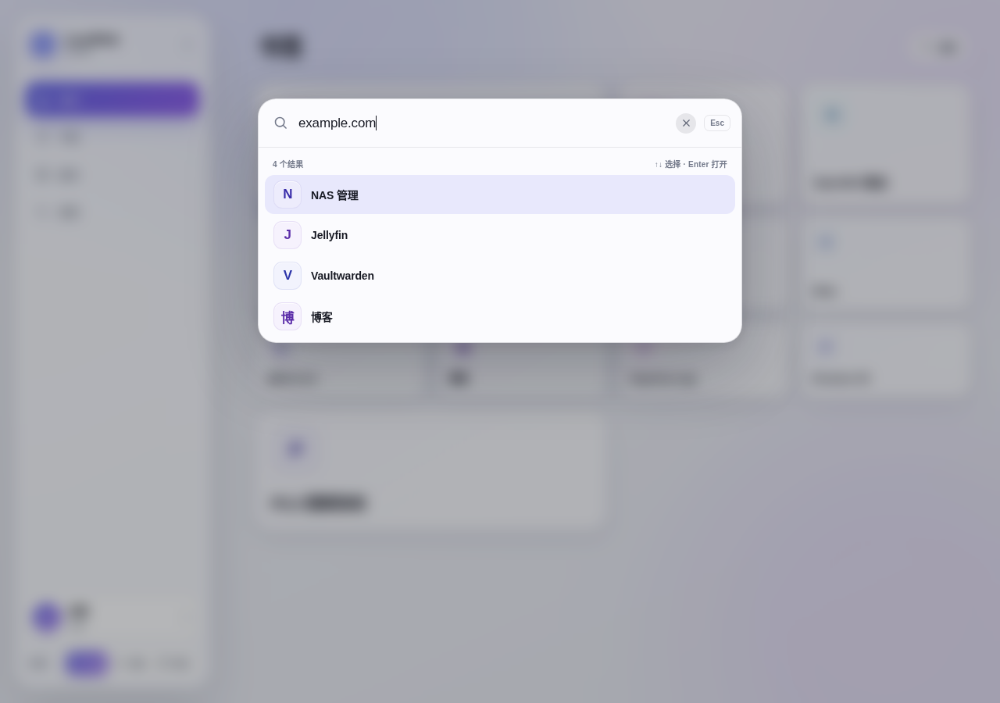
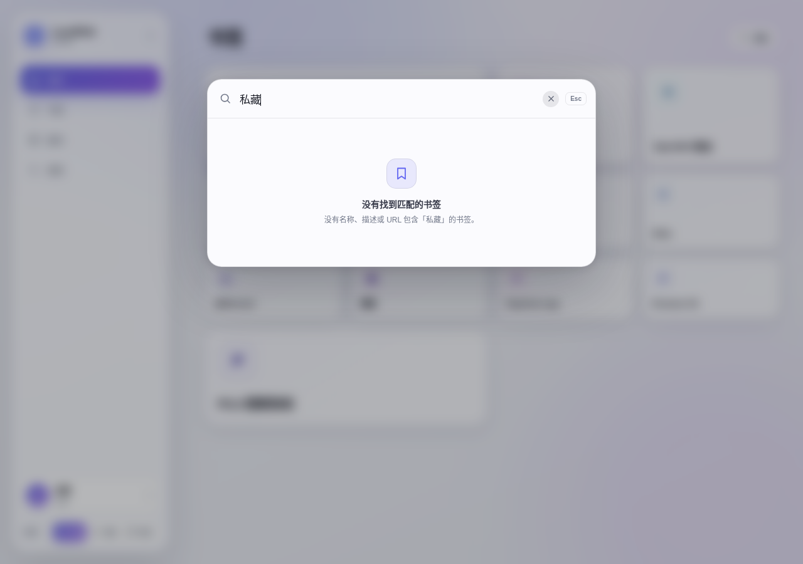
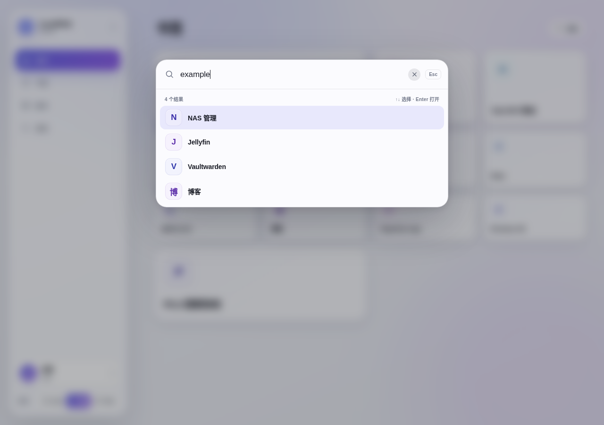
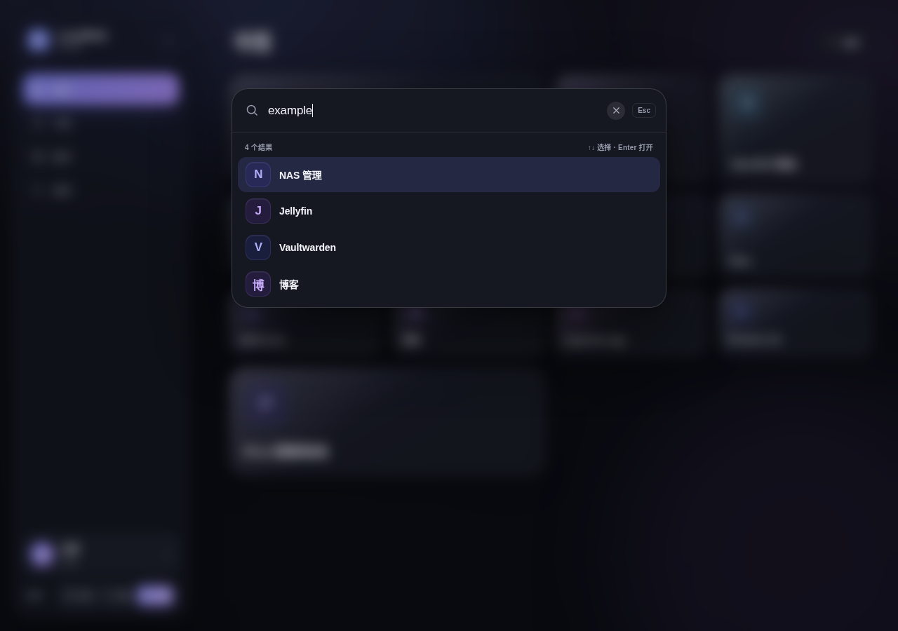
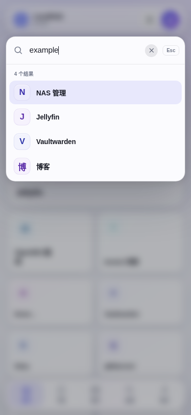
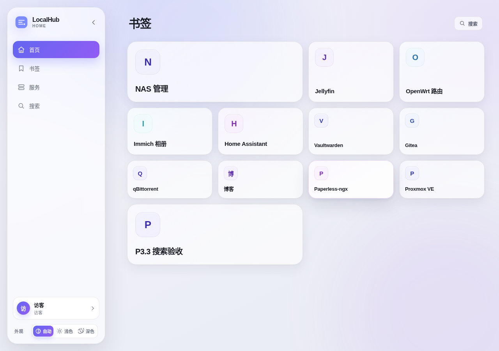
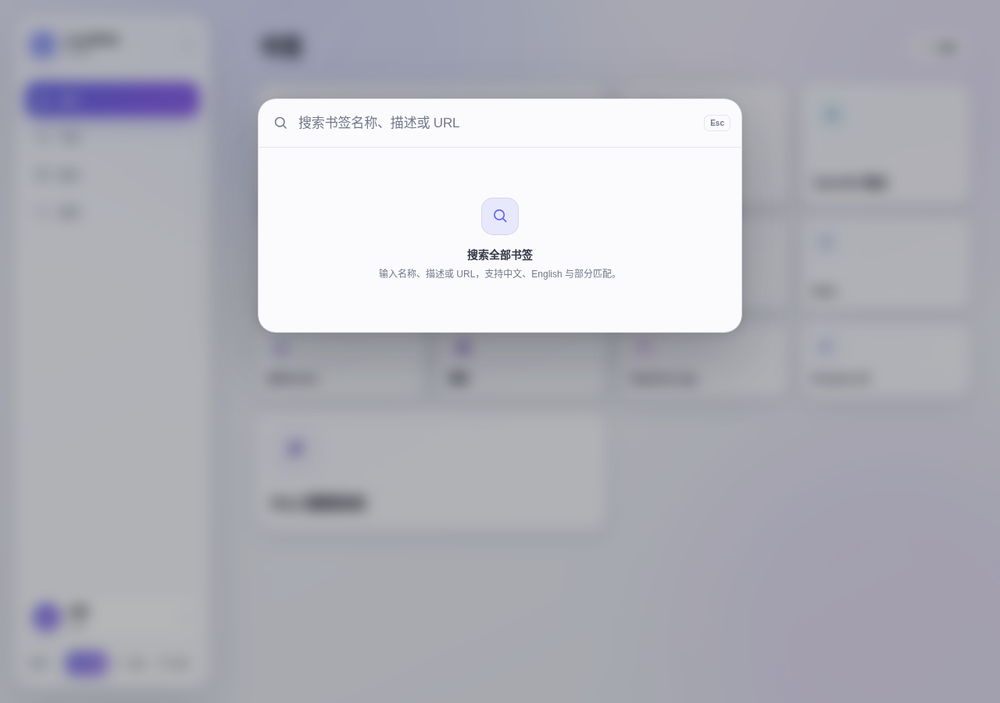
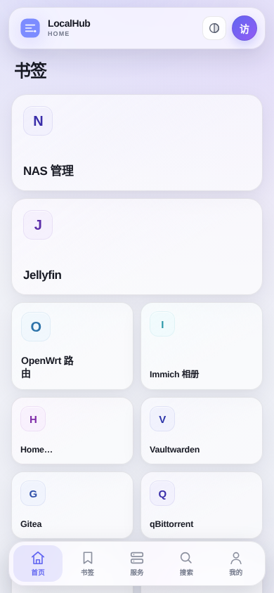

# P3.3 — 首页 Spotlight 搜索｜实施报告

- 批次：P3.3（首页 Spotlight 搜索）
- 完成日期：2026-11-28（Asia/Shanghai）
- 功能代码提交：`dc95ef5290afd07701c5cd1b47a705e47ef0647d`
- 功能提交父基线：`e9061cffe5241b66d01eb0f21716f7a9be4cd564`（P3.2 报告/证据提交）
- CI Run：[46087327198](https://github.com/laoXuHome/LocalHub/actions/runs/46087327198)
- 结论：P3.3 范围内功能、权限隔离、浏览器交互、自动化测试、多架构构建与 T12 均已完成；按停止条件不启动 P3.4 / P4。

## 1. 施工目标与本批边界

在 P3.1 首页框架和 P3.2 首页编辑能力之上，增加一个快速、克制、无分类/标签/筛选系统的 Spotlight 搜索浮层，支持按书签名称、描述、LAN/WAN URL 检索，并严格复用现有权限结果。

本批没有新增后端搜索接口，没有修改账户、权限、书签接口语义，没有修改 P3.1/P3.2 已验收的布局与编辑流程，也没有开发分类、标签、搜索历史、推荐、LAN/WAN 探测或后续模块。

## 2. 实现方案

### 2.1 纯前端搜索，不新增接口

搜索数据源就是首页已经请求的 `GET /api/bookmarks` 返回值。该接口已经按当前角色、`visibility` 与 `enabled` 过滤：

- 管理员拿到自己有权访问的公开、认证、私密书签；
- 访客只拿到公开且启用的书签；
- 禁用书签不会出现在 `/api/bookmarks` 中。

前端不请求额外数据、不缓存隐藏 ID、不拼接未返回字段，因此搜索没有新增绕过 P1/P2 权限的入口。搜索只读取已保存的书签集合，不读取编辑草稿，不写 `drafts`、`layouts`、`serverLayout`，也不调用保存接口。

### 2.2 搜索算法

`web/src/search.ts` 实现纯函数 `searchBookmarks(bookmarks, query)`：

- 对名称、描述、`lan_url`、`wan_url` 做 `NFKC` + `toLocaleLowerCase()` 归一化；
- 查询按空白拆分为多个 term，所有 term 都必须命中任一字段；
- 使用 `includes` 做部分匹配，支持中文、英文、英文大小写与 URL 片段；
- 空查询 / 纯空白返回空数组，由界面显示初始态而不是“无结果”。

### 2.3 Spotlight 浮层

`web/src/components/SpotlightSearch.tsx` 实现独立浮层：

- `role="dialog"`、`aria-modal="true"`，输入框 `type="search"`、`inputMode="search"`、`enterKeyHint="search"`；
- 打开后在 effect 中自动聚焦输入框，并锁定 `body` overflow；关闭时恢复焦点与 overflow；
- 使用 `useDeferredValue` 延迟结果计算，避免连续输入造成明显卡顿；
- 有结果时只显示书签图标与名称，不显示描述和复杂卡片；
- 无结果时显示“没有找到匹配的书签”，清空后恢复“搜索全部书签”初始态；
- 桌面支持 ↑/↓ 改变选中项、Enter 打开；鼠标悬停同步选中项；
- Escape、`Esc` 按钮、点击浮层外区域均可关闭；结果打开后自动关闭；
- 按书签已有 `open_mode` 打开：`_blank` 走 `window.open(..., 'noopener,noreferrer')`，当前页走 `window.location.assign`。

### 2.4 入口与编辑模式关系

`web/src/App.tsx` 增加 `searchOpen` 状态：

- 桌面页头“搜索”按钮、桌面左侧导航“搜索”、移动端底栏“搜索”均可打开；
- 编辑态下页头搜索入口隐藏，但侧边/底栏仍可打开，浮层只读已保存书签；
- 进入编辑（`beginEditing`）会先关闭搜索浮层；
- 搜索不会修改首页布局、草稿或编辑历史。

### 2.5 修改范围

功能提交共 5 个文件、`+635 / -13`：

| 文件 | 变更 |
| --- | --- |
| `web/src/App.tsx` | +37 / -13，搜索状态、入口、浮层挂载、进入编辑前关闭搜索 |
| `web/src/components/SpotlightSearch.tsx` | +182，新增 Spotlight 浮层组件 |
| `web/src/search.ts` | +30，新增纯搜索函数 |
| `web/src/search.test.ts` | +68，新增 7 条 Vitest |
| `web/src/style.css` | +318，Spotlight 浮层与三主题样式 |

没有后端文件、数据库 schema、迁移、Dockerfile、Compose 或 CI 工作流改动。

## 3. 验收证据

### 3.1 A. 搜索功能

浏览器实测（真实 LocalHub + 本地 SQLite schema 6，访客会话）：

| 查询 | 命中 |
| --- | --- |
| 中文名称「路由」 | OpenWrt 路由 |
| 英文大小写「jELLY」 | Jellyfin |
| 描述「streaming」 | Jellyfin |
| 描述「家庭文件」 | NAS 管理 |
| LAN URL「192.168.1.1」 | OpenWrt 路由、Proxmox VE |
| URL 片段「example」 | NAS 管理、Jellyfin、Vaultwarden、博客 |
| 部分关键词「OpenW」 | OpenWrt 路由 |
| 项目书签「P3.3」 | P3.3 搜索验收 |
| 无匹配「zzzz-no-match」 | 0 条，显示空状态 |
| 清空关键词 | 恢复“搜索全部书签”初始态 |

自动化侧，`search.test.ts` 覆盖中文名称、英文大小写、描述、LAN/WAN URL 与主机片段、跨字段多 term、空查询/无匹配，以及“只搜索传入集合、不凭空产生隐藏条目”。

### 3.2 B. 权限安全

真实 API 证据见 `docs/p3.3/permission-checks.txt`：

- 管理员 `GET /api/bookmarks`：`role=admin`，14 条；含 private `id=10`“私藏笔记”、authenticated `id=11`“财务台账”；不含 disabled `id=14`“禁用旧入口”。
- 访客 `GET /api/bookmarks`：`role=guest`，12 条；不含 `id=10/11/14`。
- 访客直接读取 `GET /api/bookmarks/10`、`GET /api/bookmarks/11`：均 HTTP 404 `{"error":"not_found","message":"书签不存在"}`，不泄露存在性；管理员读取同一条私密书签 HTTP 200。
- 未登录调用 `PUT /api/admin/bookmarks/layout`：HTTP 401 `{"error":"unauthorized","message":"需要管理员登录"}`。
- 访客布局接口只返回公开且启用的 ID：桌面/移动均为 `1,2,3,4,5,6,7,8,9,12,13,15`。
- 浏览器中访客输入「私藏」得到 0 条并显示空状态。

搜索功能没有新增接口，使用与首页相同的 `/api/bookmarks` 结果，因此不存在单独的搜索权限路径。管理员浏览器实机搜索未执行（见第 6 节已知限制），管理员侧权限由上述真实 API 证据覆盖。

### 3.3 C. 交互体验

完整记录见 `docs/p3.3/browser-checks.txt`，关键实测：

- 三处入口均可打开浮层；打开后实际焦点元素为 `.spotlight-input`；
- Escape 关闭、点击浮层外关闭、`Esc` 按钮关闭均正常；
- 输入「example.com」得到 4 条结果；ArrowDown 一次第 2 项 Jellyfin 选中（截图），再一次选中第 3 项 Vaultwarden；Enter 打开 Vaultwarden，新标签 `https://vault.example.com/`，原 LocalHub 标签保留；
- 移动端点击 Jellyfin，新标签 `https://media.example.com/jellyfin`，原标签保留；
- 两处打开均符合书签 `open_mode=new_tab`；
- 移动端输入框可聚焦并正常输入；未在 headless 截图中呈现系统软键盘（见已知限制）。

### 3.4 D. 兼容与回归

- AUTO / LIGHT / DARK 三主题均有实际截图，浮层、输入、结果、空状态可读：

- 桌面 1280×900、移动 390×844 下首页与浮层布局正常：

- 搜索前后读取布局载荷，规范化（去除 `position`）后 SHA-256 均为 `3e48dbf4067e0308e2aa6a379566be71df1ff08d2d4596bffd62fbdec85d64b2`，证明搜索没有写布局。
- 刷新首页后桌面/移动布局与搜索前一致。
- P3.1/P3.2 既有 25 条前端测试继续通过；T12 与 Docker Compose 既有冒烟继续通过（见第 4 节）。

## 4. 自动化测试与 CI

### 4.1 本地自动化

| 项目 | 结果 |
| --- | --- |
| `gofmt -l ./cmd ./internal` | 0 个未格式化文件 |
| `go vet ./...` | 通过 |
| `go test ./... -count=1` | 162 通过 / 0 失败 / 0 跳过 |
| 前端测试 | 3 个文件，32 通过 / 0 失败 / 0 跳过（P3.3 新增 7） |
| `npm run build` | 通过，45 modules；JS 185.77 kB，CSS 39.98 kB |

原始摘要见 `docs/p3.3/test-results.txt`。

### 4.2 CI Run

Run：[46087327198](https://github.com/laoXuHome/LocalHub/actions/runs/46087327198)（提交 `dc95ef5290afd07701c5cd1b47a705e47ef0647d`）

| Job | ID | 结果 | 耗时 |
| --- | --- | --- | --- |
| 前端构建 | `140799860515` | success | 16s |
| Go 质量与测试 | `140799860687` | success | 37s |
| 多架构镜像与 T12 验证 | `140800060149` | success | 7m1s |

### 4.3 多架构镜像验证

| 镜像 | ID | 大小 | `--version` |
| --- | --- | --- | --- |
| `localhub:amd64` | `d08e80384b72` | 22.1MB | `localhub v0.1.0-p0 commit=dc95ef5290afd07701c5cd1b47a705e47ef0647d build_time=2026-11-28T00:21:06Z` |
| `localhub:arm64` | `3ac5abd01531` | 5.21MB | `localhub v0.1.0-p0 commit=dc95ef5290afd07701c5cd1b47a705e47ef0647d build_time=2026-11-28T00:21:42Z` |

### 4.4 T12 与容器验证

- T12 专项验证（amd64）：`RESULT: ALL PASS`，28 PASS / 0 FAIL。
- arm64 QEMU 运行：`/health` HTTP 200，`status=ok`，`schema_version=6`，`uid/gid=1000`；SIGTERM 后 `exit_code=0`。
- Docker Compose 启动与健康检查：`/health` HTTP 200，`schema_version=6`，`writable=true`；既有认证、图标、导入导出冒烟全部通过。

CI artifact：`verification-dc95ef5290afd07701c5cd1b47a705e47ef0647d`，包含 `t12.log`、`t12-logs/`、`images.txt`、`version-amd64.txt`、`version-arm64.txt`、`health-arm64.json`、`health-compose.json`、`compose-up.txt` 等。

## 5. 截图与证据清单

目录：[docs/p3.3](https://github.com/laoXuHome/LocalHub/tree/main/docs/p3.3)

| 文件 | 内容 |
| --- | --- |
| `desktop-home-search-entry.png` | 1280×900 桌面首页搜索入口 |
| `desktop-search-initial.png` | 桌面浮层初始态、自动聚焦 |
| `desktop-search-results-auto.png` | AUTO 主题 4 条结果 |
| `desktop-search-results-light.png` | LIGHT 主题 4 条结果 |
| `desktop-search-results-dark.png` | DARK 主题 4 条结果 |
| `desktop-search-keyboard.png` | 方向键选中第 2 项 Jellyfin |
| `desktop-search-no-result.png` | 无匹配空状态 |
| `desktop-guest-private-empty.png` | 访客搜索私藏书签为空 |
| `mobile-home.png` | 390×844 移动首页与底栏搜索入口 |
| `mobile-search-initial.png` | 移动浮层初始态、自动聚焦 |
| `mobile-search-results.png` | 移动端 4 条结果 |
| `permission-checks.txt` | 管理员/访客列表、404、401、布局 SHA |
| `browser-checks.txt` | 浏览器搜索、键盘、关闭、打开方式、主题、布局记录 |
| `test-results.txt` | 本地测试与构建摘要 |

## 6. 已知限制与未完成事项

1. 管理员浏览器实机搜索未执行。当前浏览器为访客会话；管理员权限由真实 `GET /api/bookmarks`、私密书签 200/404 对比等 API 证据覆盖，未在浏览器 UI 中再次登录管理员。
2. 管理员编辑态下打开/关闭搜索的实机组合操作未执行。代码路径确认搜索只读 `bookmarks`、不写草稿/布局，且 `beginEditing` 会先关闭搜索；但没有对应的管理员浏览器截图。
3. `open_mode=self` 的搜索结果没有实机打开验证。代码按 `bookmarkTarget` 判断，`self` 使用 `window.location.assign`；浏览器只实测了 `new_tab`。
4. 移动端系统软键盘无法在 headless 环境呈现。已验证输入框聚焦、`type=search`、`inputMode=search`、`enterKeyHint=search` 及实际输入结果，但没有软键盘截图。
5. 本批未新增搜索专用的后端/CI E2E 用例。搜索由 7 条 Vitest 与真实浏览器验收覆盖；CI 的 T12/Compose 是既有回归套件。
6. P3.3 报告/证据为纯文档提交，不会改变功能提交 `dc95ef5290afd07701c5cd1b47a705e47ef0647d` 的 CI 结论；验收应以该功能 Run `46087327198` 为准。

## 7. 停止状态

P3.3 已完成并停止。未启动 P3.4，未进入 P4，未开发 Docker、Backup、Settings 等后续模块。等待项目负责人验收；只有负责人验收通过且用户明确说出“下一步”后，才启动下一批施工。
