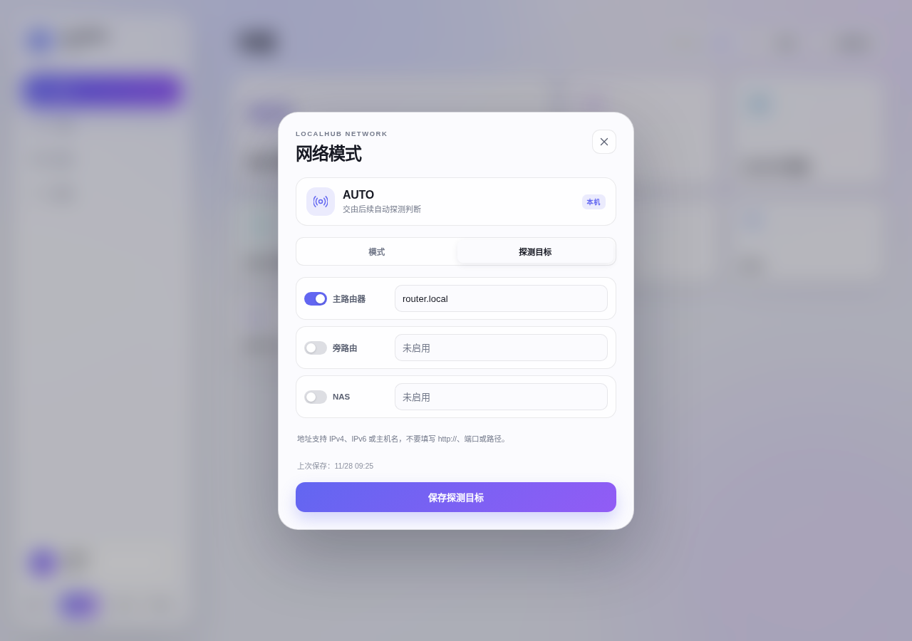
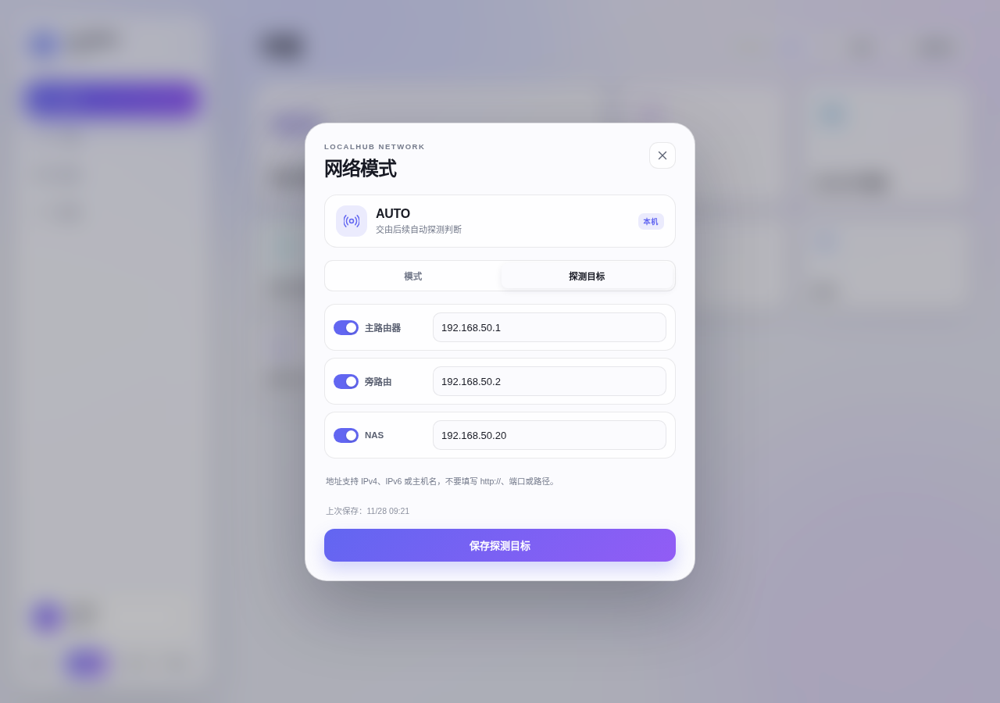
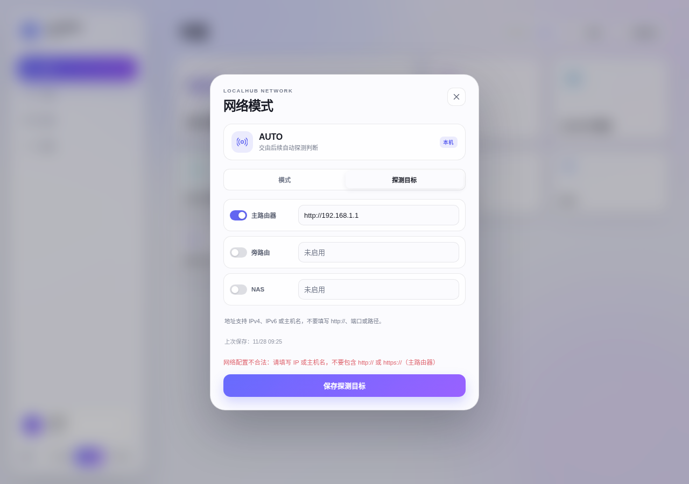
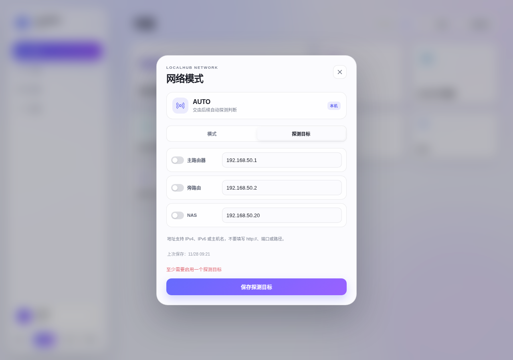
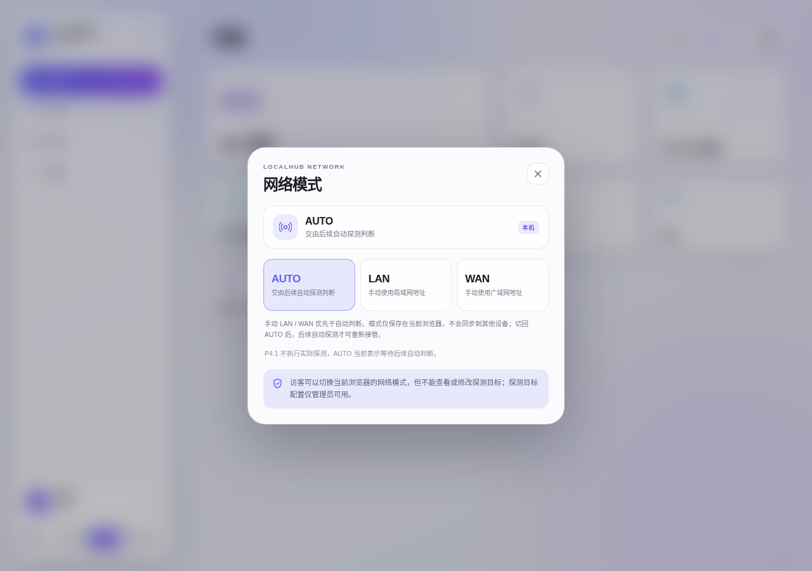
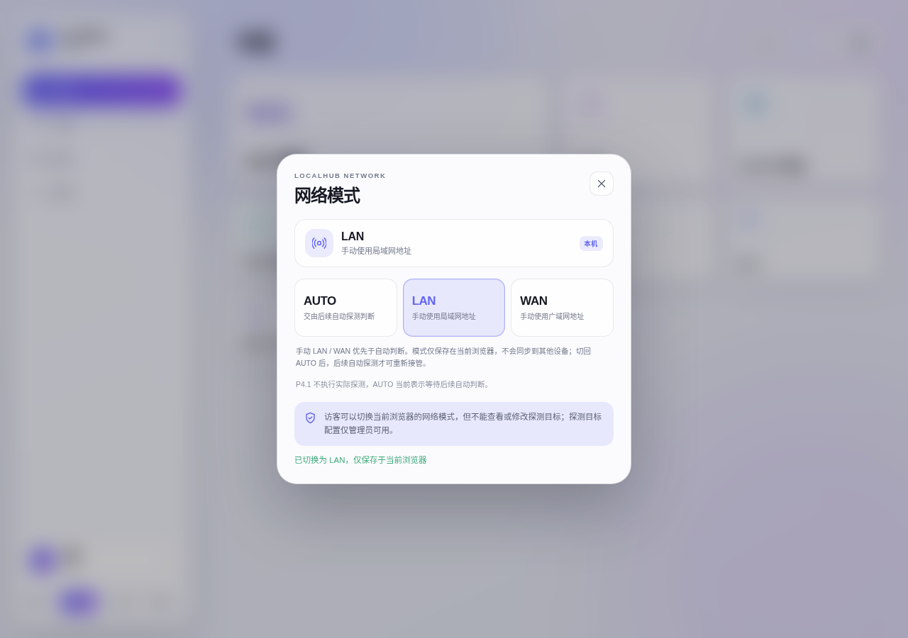
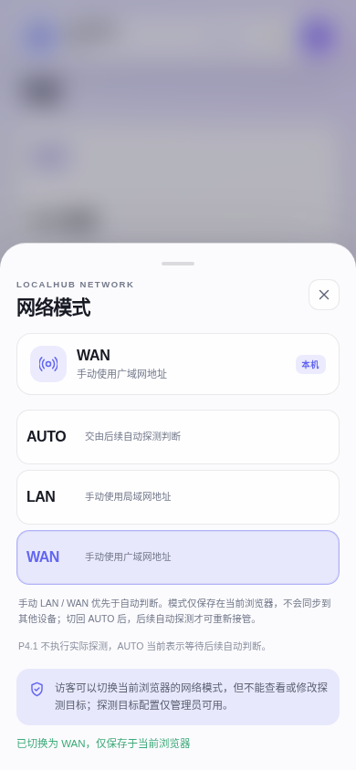
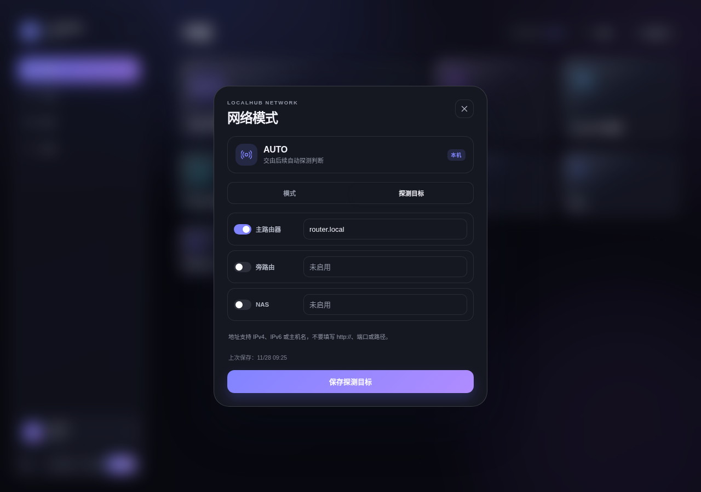

# P4.1 — 网络配置与模式管理｜实施报告

- 批次：P4.1（网络配置与模式管理）
- 完成日期：2026-11-28（Asia/Shanghai）
- 功能代码提交：`17029058d2650ae7eb531c986f0646215bc99353`
- 功能提交父基线：`f0b3893764ef2232827f935093c1874c988c53b8`（P3.3 报告/证据提交）
- CI Run：[46093987885](https://github.com/laoXuHome/LocalHub/actions/runs/46093987885)
- 结论：P4.1 范围内配置持久化、管理员权限、AUTO/LAN/WAN 本机模式、桌面/移动入口、三主题、自动化测试、amd64/arm64 构建、CI 与 T12 均已完成；按停止条件未启动 P4.2 / P5，未实施任何实际探测。

## 1. 施工目标与边界

在 LocalHub P3.3 首页基础上，建立 LAN/WAN 网络切换所需的配置与状态基础：

- 三个固定探测目标（主路由器、旁路由、NAS）可独立编辑地址、独立启用/禁用；
- 配置由管理员维护并持久化到 SQLite；至少一个目标启用；地址合法性校验；
- AUTO / LAN / WAN 三种模式可切换；手动模式只属于当前浏览器/设备；
- 首页提供入口并显示当前模式；桌面/移动、AUTO/LIGHT/DARK 三主题可用。

本批**没有**实施 HTTP 探测、Ping、LAN/WAN 自动判断、定时/后台检测，也**没有**修改书签 LAN/WAN URL 选择逻辑、P1/P2 已有接口语义、账户权限或 Docker/Backup/通知功能。

## 2. 实现方案

### 2.1 服务端配置与持久化

新增 `internal/network` 包和迁移 `0007_network.sql`（schema 6 → 7）：

- 固定三个 key：`router`、`bypass_router`、`nas`；标签由服务端固定为「主路由器 / 旁路由 / NAS」；客户端不能新增、删除或改标签。
- `network_targets` 表：`target_key` 主键并受 CHECK 约束，`address`、`enabled`、`updated_at`。
- 初始 seed：主路由器 `router.local` 启用；旁路由、NAS 空地址且禁用。刻意不写死 `192.168.x.x` 等常见用户网段；`updated_at` 使用迁移执行时间，不显示 1970。
- `Normalize` 要求恰好提交三个固定 key 且不重复；启用目标地址必须合法；禁用但非空地址也必须合法；启用数为 0 返回 `ErrInvalid`。
- `Save` 在单个 SQLite 事务内 UPSERT 三行，提交后重新读取，避免部分写入。
- 地址校验接受 IPv4、IPv6、主机名；拒绝空/空白、`://`、路径/查询/用户信息、端口、非法 IPv4（如 `999.999.999.999`）、纯数字、非法主机名标签、下划线、首尾连字符。主机名允许末尾点，最大长度 253。
- “至少一个启用”是跨行约束，SQLite CHECK 无法表达，由 Store/API 强制；迁移默认配置满足。

管理员接口：

| 方法 | 路径 | 权限 | 说明 |
| --- | --- | --- | --- |
| GET | `/api/admin/network/targets` | 管理员 | 读取三目标配置 |
| PUT | `/api/admin/network/targets` | 管理员 | 全量保存三目标 |

两条路由均包在现有 `requireAdmin` 内，沿用 same-origin/CSRF 与会话校验。错误码：`invalid_network_config`（400）、`unauthorized`（401）、`database_unavailable`（503）。没有新增访客可读配置接口，访客无法读取或修改探测目标地址。

### 2.2 浏览器本地模式

`web/src/network.ts` 只使用 `localStorage`，key 为 `localhub.networkMode`，值限定 `auto|lan|wan`，默认 `auto`：

- 无值、损坏值、存储不可用均回退 AUTO；
- `persistNetworkMode` 返回是否写入成功；失败时界面提示“仅在本次会话有效”；
- 同一浏览器标签页通过 `storage` 事件同步；
- 不同浏览器/设备各有自己的 localStorage，不进入账户、SQLite 或服务端配置，因此没有跨设备同步通道；
- 纯函数 `effectiveNetworkMode(preference, detected)` 建立“手动 LAN/WAN 永远优先，只有 preference=AUTO 才采用 detected”的语义。P4.1 的 `detected` 固定 AUTO，供后续 P4.2 接入。

### 2.3 页面入口与面板

- 桌面页头：`网络` + 当前 `AUTO/LAN/WAN`；移动 topbar：网络图标 + 当前模式；编辑态隐藏。
- `NetworkSheet` 顶部显示当前模式、“本机”标识、模式说明和“P4.1 不执行实际探测”提示。
- 管理员面板有「模式 / 探测目标」两个 tab；访客只有模式区，并显示“不能查看或修改探测目标”。
- 模式点击立即保存并提示“仅保存于当前浏览器”；三目标独立开关、独立地址输入、保存按钮、上次保存时间、加载骨架与错误态。
- 前端先检查“至少一个启用”“启用目标地址非空”，后端仍完整校验并返回 400 详情。
- Escape、点击遮罩外关闭；锁定 body overflow；初始聚焦 AUTO；≤600px 模式选项与目标行改单列；≤900px 隐藏桌面网络入口，仅保留移动 topbar 入口，修复 768px 断点双入口问题。
- 样式延续现有 P3.1–P3.3 CSS 变量与 AUTO/LIGHT/DARK 三主题。

### 2.4 修改范围

功能提交共 **16 个文件，+1668 / -2**：

| 文件 | 变更 |
| --- | --- |
| `internal/network/model.go` | +177，目标模型、默认值、地址校验、Normalize |
| `internal/network/model_test.go` | +126，模型与校验测试 |
| `internal/network/store.go` | +123，SQLite Get/Save/GetByKey |
| `internal/network/store_test.go` | +116，重开库持久化、非法保存不部分写入 |
| `internal/approle/network_http.go` | +46，管理员 GET/PUT |
| `internal/approle/network_http_test.go` | +115，权限、校验、保存 HTTP 测试 |
| `internal/approle/approle.go` | +4，两条 admin 路由 |
| `internal/db/migrations/0007_network.sql` | +15，schema 7 与默认配置 |
| `web/src/types.ts` | +17，网络类型 |
| `web/src/api.ts` | +17 / -1，网络 API 客户端 |
| `web/src/network.ts` | +66，localStorage 与模式纯函数 |
| `web/src/network.test.ts` | +69，7 条模式测试 |
| `web/src/components/Icons.tsx` | +10，NetworkIcon |
| `web/src/components/NetworkSheet.tsx` | +268，网络面板 |
| `web/src/App.tsx` | +66 / -1，入口、状态、storage 同步、挂载 |
| `web/src/style.css` | +433，入口、面板、响应式、三主题样式 |

没有修改 Dockerfile、Compose、CI 工作流或 P1/P2 接口。

## 3. 验收证据

### 3.1 配置与持久化

| 验收项 | 结果 | 证据 |
| --- | --- | --- |
| 三个目标独立编辑/启用 | PASS | 管理员面板截图；HTTP 测试保存三目标 |
| 至少一个启用 | PASS | 全禁用 PUT 400；前端阻止并提示 |
| 非法地址不能保存 | PASS | `http://` 前缀、`999.999.999.999` 均 400；界面显示中文错误 |
| 刷新后配置存在 | PASS | 浏览器刷新后重开目标 tab 仍为三目标；API GET 一致 |
| 服务重启后存在 | PASS | 独立库 11031：保存 → 停服 → 重启 → GET 值/`updated_at` 完全一致 |
| 访客不能修改 | PASS | 访客 GET/PUT 均 401；访客 UI 无探测目标 tab |

默认配置证据 `docs/p4.1/admin-default.json`：`router.local` 启用，旁路由/NAS 空且禁用，`updated_at=2026-11-28T01:25:43Z`。

服务重启证据：`docs/p4.1/persist-before-restart.json`、`persist-after-restart.json`，流程见 `persistence.txt`；测试使用独立数据目录，三目标保存为 `10.10.0.1 / 10.10.0.2 / 10.10.0.20`（测试地址，不是用户网络）。

权限与非法请求原始响应见 `docs/p4.1/permission-and-validation.txt`：

```
访客 GET  -> HTTP 401 {"error":"unauthorized","message":"需要管理员登录"}
访客 PUT  -> HTTP 401 {"error":"unauthorized","message":"需要管理员登录"}
http:// 地址 -> HTTP 400 invalid_network_config
全部禁用 -> HTTP 400 invalid_network_config
999.999.999.999 -> HTTP 400 invalid_network_config
```

非法请求后重新 GET，仍为默认三目标，未发生部分写入。









### 3.2 模式与本地偏好

| 验收项 | 结果 | 证据 |
| --- | --- | --- |
| AUTO/LAN/WAN 可切换 | PASS | 桌面 LAN、移动 WAN、切回 AUTO 截图与 toast |
| 手动模式刷新保持 | PASS | LAN 刷新后仍 LAN；WAN 刷新后仍 WAN |
| 不同浏览器/设备互不影响 | PASS（单元级） | `network.test.ts` 两个独立 storage：A=LAN，B 仍 AUTO；无服务端模式接口 |
| 切回 AUTO 状态正确 | PASS | 桌面/移动切回后入口显示 AUTO，刷新仍 AUTO |
| 初始默认 AUTO | PASS | 无存储值读取 auto；截图初始状态 AUTO |

模式只写当前浏览器，不进入账户/SQLite；代码中没有模式读取或写入 API，因此不存在向其他设备暴露本机选择的接口。







### 3.3 桌面、移动与三主题

| 场景 | 结果 | 截图 |
| --- | --- | --- |
| 桌面 1280×900 首页 AUTO | PASS | `desktop-home-auto.png` |
| 桌面浅色 | PASS | `desktop-home-light.png` |
| 桌面深色 | PASS | `desktop-home-dark.png` |
| 桌面网络面板浅色/深色 | PASS | `desktop-network-auto.png` / `desktop-network-dark.png` |
| 移动 390×844 首页/面板 | PASS | `mobile-home.png` / `mobile-network-auto.png` |
| 移动管理员目标配置 | PASS | `mobile-admin-targets.png` |
| 768×900 平板单入口 | PASS | `tablet-home-768.png` |

管理员深色目标面板：



桌面与移动入口均可见、可点击；≤900px 只保留移动 topbar 网络入口，不再出现双入口。

### 3.4 P3.1–P3.3 回归

浏览器检查确认书签卡片、搜索入口、编辑入口、账户入口、外观切换和首页布局未被网络入口破坏；网络面板关闭后首页恢复。完整记录见 `docs/p4.1/browser-checks.txt`。

## 4. 自动化测试、CI 与多架构

### 4.1 测试

- `gofmt -l ./cmd ./internal`：无输出。
- `go vet ./...`：通过。
- `go test ./... -count=1`：全部包 ok；`go test -v ./...` 共 **168** 个 `=== RUN`，0 失败。
- P4.1 新增 Go 测试：`internal/network` 5 个顶层测试函数，`internal/approle` 1 个管理员权限/校验 HTTP 测试。
- 前端 `npm test -- --run`：4 个文件、**39 passed / 0 failed**；其中 `network.test.ts` 7 条。
- 前端 `npm run build`：47 modules，CSS 46.23 kB、JS 193.11 kB，成功。

完整输出见 `docs/p4.1/test-results.txt`。

### 4.2 CI 与镜像

- CI Run：`46093987885`，`success`，head `17029058d2650ae7eb531c986f0646215bc99353`。
- Go 质量与测试：success（job `140821064317`）。
- 前端构建：success（job `140821064562`）。
- 多架构镜像与 T12 验证：success（job `140821210970`）。
- amd64 镜像：`22.2MB`（ID `375d50bdba13`）。
- arm64 镜像：`5.21MB`（ID `55d2045821b9`）。
- arm64 QEMU：`/health` HTTP 200，`schema_version=7`，TERM 后 `exit_code=0`。
- T12：**28 PASS / 0 FAIL，RESULT: ALL PASS**；A5 重建后数据仍在，schema_version=7。

详见 `docs/p4.1/ci-summary.txt`。

## 5. 已知限制与未完成事项

1. **没有实际探测**：AUTO 当前只表示“等待后续自动判断”，没有 HTTP/Ping/定时/后台检测；这是 P4.1 任务书要求。
2. **手动模式尚未接入书签 URL 选择**：P4.1 只管理模式状态；任务书明确禁止修改书签 LAN/WAN URL 选择逻辑。`effectiveNetworkMode` 已建立优先语义，待 P4.2/后续消费。
3. **不同设备互不影响为单元级证据**：通过两个独立 storage 测试证明本地偏好隔离；没有服务端模式接口，因此结构上不存在跨设备同步。未用两台真实浏览器做端到端对照。
4. **管理员截图使用本地测试夹具**：5180 仅用于渲染生产构建并注入本地测试管理员会话；真实 API 仍为 11030。产品代码不含登录绕过，测试口令未写入仓库或报告。管理员配置的保存、权限、持久化均有真实 API 证据。
5. **本地无 Docker**：当前执行环境无 `docker`，T12 由 CI 执行；本地仅完成 amd64/arm64 交叉编译。
6. **移动端未实机输入长地址**：移动端已验证入口、tab 切换、面板滚动与模式切换；长地址输入由桌面与 API 测试覆盖。
7. **截图使用样例数据**：书签与网络地址为测试数据（如 `example.com`、`192.168.x.x`、`10.10.0.x`）；本地主库最终已重置为占位配置，未写入任何用户真实网络地址。

## 6. 停止状态

P4.1 已完成并提交报告。未启动 P4.2，未实现 HTTP 探测、Ping、自动判断、定时/后台检测或 P5 功能。等待项目负责人验收；只有负责人验收通过且用户明确说出“下一步”，才允许启动下一批。
