# P4.2 — HTTP 网络探测引擎｜实施报告

- 批次：P4.2（HTTP 网络探测引擎）
- 完成日期：2026-11-28（Asia/Shanghai）
- 功能代码提交：`9de96c6ab5aa71e737510d720ef5e33bc9caadd0`
- 功能提交父基线：`4c68a605082df20c50de446061655271857bffc4`（P4.1 报告/证据提交）
- 提交链接：[9de96c6](https://github.com/laoXuHome/LocalHub/commit/9de96c6ab5aa71e737510d720ef5e33bc9caadd0)
- CI Run：[46099506706](https://github.com/laoXuHome/LocalHub/actions/runs/46099506706)，`success`
- 结论：P4.2 范围内手动 HTTP/HTTPS 探测、结果持久化、公开/管理员接口、防重复并发、SSRF/重定向/超时/响应体限制、桌面/移动/三主题展示、自动化测试、amd64/arm64 构建、CI 与 T12 均已完成；未实施自动 LAN/WAN 判断、定时/后台探测或书签 URL 切换，未启动 P4.3/P5。

## 1. 施工目标与边界

在 P4.1 已完成的 `network_targets` 配置基础上，只增加真实探测执行与结果展示：

- 对主路由器、旁路由、NAS 三个固定目标独立发起 HTTP/HTTPS 请求；
- 每个目标独立超时、独立失败，一个失败不阻塞其他目标；
- 成功只认 HTTP 2xx；连接失败、超时、HTTP 错误、其他异常分别记录；
- 最新结果持久化，服务重启后可读取；地址变更或未探测不误报成功；
- 管理员手动触发，访客只能看脱敏状态；
- 不新增任意 URL 探测入口，不跟随重定向，限制并发、整体耗时和响应体大小。

本批**没有**实施 Ping、定时探测、页面加载自动探测、后台周期探测、LAN/WAN 自动判断、AUTO 自动切换，也**没有**修改书签 LAN/WAN URL 选择逻辑或 P4.1 手动模式优先规则。

## 2. 实现方案

### 2.1 固定目标与地址校验

探测目标只能来自 P4.1 的三个固定 key：`router`、`bypass_router`、`nas`。手动触发接口 `POST /api/admin/network/probe` 不接受任何 URL、地址或目标参数，请求体被忽略；服务端每次从 `network_targets` 读取当前配置。

地址复用 P4.1 的 `network.ValidateAddress`：只接受 IPv4、IPv6 或主机名；拒绝 scheme、路径、查询、用户信息、端口、非法 IP 和非法主机名。探测 URL 由 `scheme + "://" + 已校验 host + "/"` 构造，调用方不能追加路径或查询。地址不合法时返回 `probe_error`，不发起请求。

### 2.2 结果与配置分表

新增迁移 `0008_network_probe.sql`，schema 7 → 8：

```sql
CREATE TABLE network_probe_results (
    target_key  TEXT PRIMARY KEY CHECK (target_key IN ('router','bypass_router','nas')),
    address     TEXT NOT NULL,
    status      TEXT CHECK (status IN ('success','http_error','timeout','connection_failed','probe_error')),
    http_status INTEGER NOT NULL DEFAULT 0,
    latency_ms  INTEGER NOT NULL DEFAULT 0,
    checked_at  TEXT NOT NULL,
    reason      TEXT NOT NULL DEFAULT ''
);
```

`network_targets` 配置表不新增、不修改任何列；探测只写 `network_probe_results`。`not_probed` 不入库，由“无记录”或“结果地址 ≠ 当前配置地址”推导；`disabled` 由当前配置推导。保存配置后清理禁用目标的旧结果，重新启用时回到未探测。

### 2.3 状态语义

| 状态 | 触发条件 | 是否入库 | 展示 |
| --- | --- | --- | --- |
| `success` | HTTP 2xx 且响应体未超限 | 是 | 绿点 `#16A34A` |
| `http_error` | 3xx/4xx/5xx | 是，记录 HTTP 码 | 红点 `#DC2626` |
| `timeout` | 连接/响应头/读取超时 | 是 | 红点 |
| `connection_failed` | 连接拒绝、DNS、TLS 等连接层失败 | 是 | 红点 |
| `probe_error` | 响应体超限、读取异常、地址非法 | 是 | 红点 |
| `not_probed` | 无结果或结果地址与当前配置不一致 | 否 | 灰点 `#9CA3AF` |
| `disabled` | 当前配置禁用 | 否 | 灰点；不请求 |

### 2.4 探测执行

- 先请求 `http://host/`；只有首次结果为 `connection_failed` 才尝试 `https://host/`，避免对普通 HTTP 设备重复等待。
- HTTPS 使用 Go 默认证书校验，不跳过 TLS。
- `Proxy: nil` 强制直连；`CheckRedirect=ErrUseLastResponse` 禁止跟随重定向。
- 单目标 `DefaultTimeout=4s`；拨号 2s、TLS 2s、响应头 3s。
- 整体 `RunTimeout=8s`；最多 3 目标并行；`MaxConnsPerHost=2`。
- 响应体上限 `64 KiB`：先查 `Content-Length`，再用 `io.CopyN(maxBody+1)` 限制实际读取。
- 手动触发异步执行：`POST` 立即返回 202 与 `run_id`；已有探测运行时再次触发返回 409 `probe_in_progress`，不排队、不堆积。
- 单次执行记录只在进程内保留，最多 20 条；最新结果持久化。

### 2.5 接口与权限

| 方法 | 路径 | 权限 | 说明 |
| --- | --- | --- | --- |
| GET | `/api/network/status` | 公开 | 仅 key/label/enabled/status/http_status/latency_ms/checked_at |
| GET | `/api/admin/network/results` | 管理员 | 额外包含 address 与 failure_reason |
| POST | `/api/admin/network/probe` | 管理员 | 无 URL 参数，202 返回 run_id |
| GET | `/api/admin/network/probes/{id}` | 管理员 | 返回单次 run；不存在/重启后 404 |

不存在 `/api/network/probe`，也不存在任何接受任意 URL 的探测接口。管理员路由沿用现有会话、same-origin/CSRF 校验；访客 GET/POST 均 401，跨站 POST 403。

### 2.6 页面

`NetworkSheet` 管理员增加「模式 / 探测结果 / 探测目标」三个 tab；访客在模式页下方只看到脱敏结果。结果行显示目标名、状态点、HTTP 码、耗时、最近时间；管理员额外有失败原因、目标地址和「手动探测」按钮。

探测中按钮显示「正在探测…」并禁用，下方显示 spinner 与“正在并行探测三个目标，请稍候…”；完成后 toast 汇总成功数。移动端结果行与按钮改纵向布局，页面无横向溢出。

### 2.7 修改范围

功能提交共 **19 个文件，+1987 / -14**：

| 文件 | 变更 |
| --- | --- |
| `internal/db/migrations/0008_network_probe.sql` | +16，schema 8 与结果表 |
| `internal/probe/result.go` | +99，状态、Result、公开脱敏模型 |
| `internal/probe/store.go` | +143，结果保存、清理、读取与地址变更失效 |
| `internal/probe/engine.go` | +183，HTTP/HTTPS 探测、超时、响应体、重定向 |
| `internal/probe/manager.go` | +175，单航班、并发、整体超时、run 历史 |
| `internal/probe/engine_test.go` | +170，6 个探测测试 |
| `internal/probe/store_test.go` | +156，2 个持久化测试 |
| `internal/probe/manager_test.go` | +150，2 个调度测试 |
| `internal/approle/network_probe_http.go` | +93，四个探测接口 |
| `internal/approle/network_probe_http_test.go` | +174，权限/脱敏/防重复测试 |
| `internal/approle/approle.go` | +11，注册路由 |
| `internal/approle/network_http.go` | +2 / -1，保存配置后清理禁用结果 |
| `internal/approle/auth_http_test.go` | +2，管理员路由鉴权覆盖 |
| `web/src/probe.ts` | +52，状态文案与时间格式化 |
| `web/src/probe.test.ts` | +41，5 条前端测试 |
| `web/src/components/NetworkSheet.tsx` | +272 / -13，结果 tab、手动按钮、轮询、访客视图 |
| `web/src/style.css` | +196，状态点、结果行、响应式 |
| `web/src/api.ts` | +18，探测 API 客户端 |
| `web/src/types.ts` | +34，探测类型 |

没有修改 Dockerfile、Compose、CI 工作流、书签模型、书签 URL 选择或 P4.1 模式规则。

## 3. 验收结果

| # | 验收项 | 结果 | 证据 |
| --- | --- | --- | --- |
| 1 | 三个目标分别成功探测 | PASS | run `probe-b27dc5da16384240`：200/200/200，5/5/4ms |
| 2 | 三个目标独立失败，不互相阻塞 | PASS | run `probe-f26e9bb336fba7f3`：timeout + 503 + success 同批完成 |
| 3 | 超时、连接失败、HTTP 错误正确区分 | PASS | 3003ms timeout、503 `http_error`、`connection_failed` 分别记录 |
| 4 | 禁用目标不发起探测 | PASS | 计数夹具 `/__count=0`；run 中 NAS 为 `disabled` |
| 5 | 未探测状态不误报成功 | PASS | 地址变更后主路由灰点“未探测” |
| 6 | 结果持久化，服务重启后可读 | PASS | 重启前后 admin/public/targets 三份 JSON 逐字一致 |
| 7 | 历史结果不被误报为当前实时成功 | PASS | 保留原 `checked_at`；页面文案“最近一次手动探测，不代表当前实时可达” |
| 8 | 管理员可以手动触发 | PASS | 202；页面按钮、running 截图 |
| 9 | 访客不能触发探测 | PASS | GET/POST 管理员接口均 401 |
| 10 | 访客不能读内部错误和敏感配置 | PASS | 公开响应无 address、无 failure_reason |
| 11 | 任意 URL 探测接口不存在 | PASS | `/api/network/probe?url=` 404；POST 忽略请求体 |
| 12 | SSRF、防重定向、超时、响应体限制 | PASS | 302 不跟随；80KiB 超限；64KiB 上限；非法地址不请求 |
| 13 | 重复触发不堆积 | PASS | 第二次 POST 409，返回同一 run_id |
| 14 | 桌面、移动、三主题正常 | PASS | 1280×900、390×844、AUTO/LIGHT/DARK 截图 |
| 15 | P3.1/P3.2/P3.3/P4.1 回归 | PASS | 书签、编辑、Spotlight、P4.1 配置截图 + 全量 Go/前端测试 |
| 16 | amd64、arm64 构建 | PASS | 本地交叉编译 + CI 镜像；arm64 QEMU `/health` 200 |
| 17 | CI 全部通过、T12 全部通过 | PASS | run `46099506706` success；T12 28 PASS / 0 FAIL |

## 4. 证据

### 4.1 三目标成功

run `probe-b27dc5da16384240`：

```
router         address=127.0.0.1  status=success  http=200  latency=5ms
bypass_router  address=127.0.0.3  status=success  http=200  latency=5ms
nas            address=127.0.0.4  status=success  http=200  latency=4ms
```

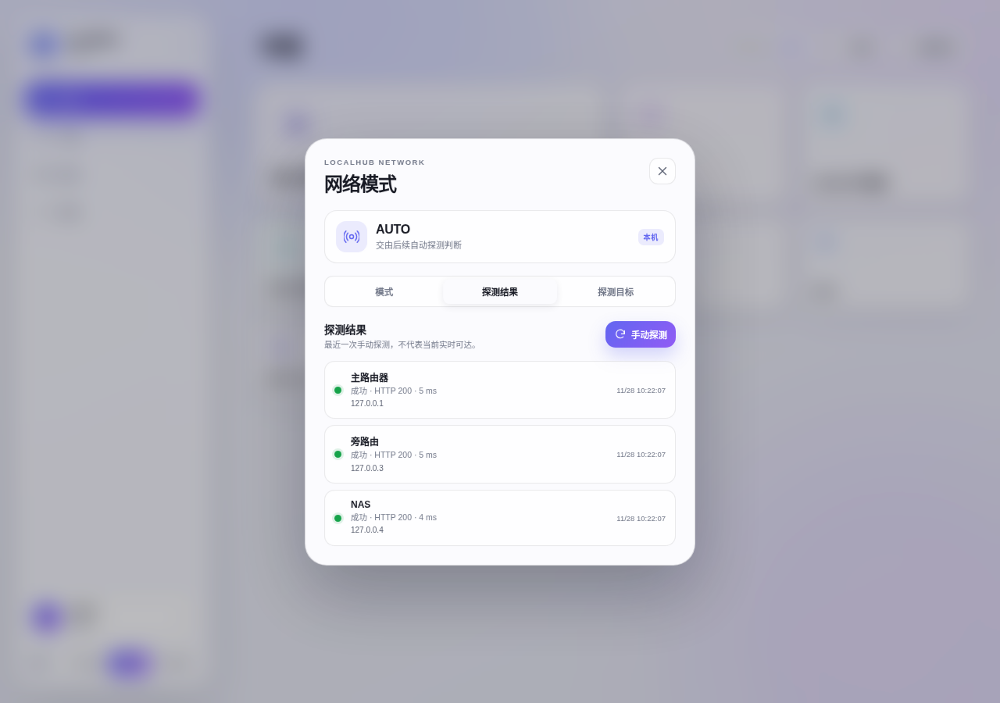

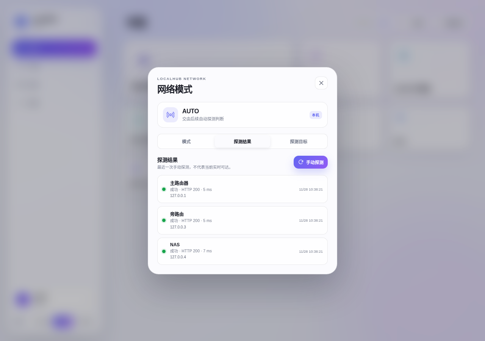

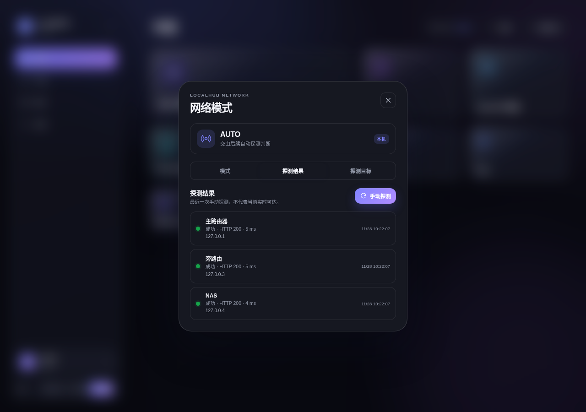

### 4.2 独立失败与错误分类

run `probe-f26e9bb336fba7f3`：

```
router         timeout       latency=3003ms  reason=探测超时
bypass_router  http_error    http=503
nas            success       http=200        latency=8ms
```

页面另一次同配置探测显示 `1/3 个目标成功`：

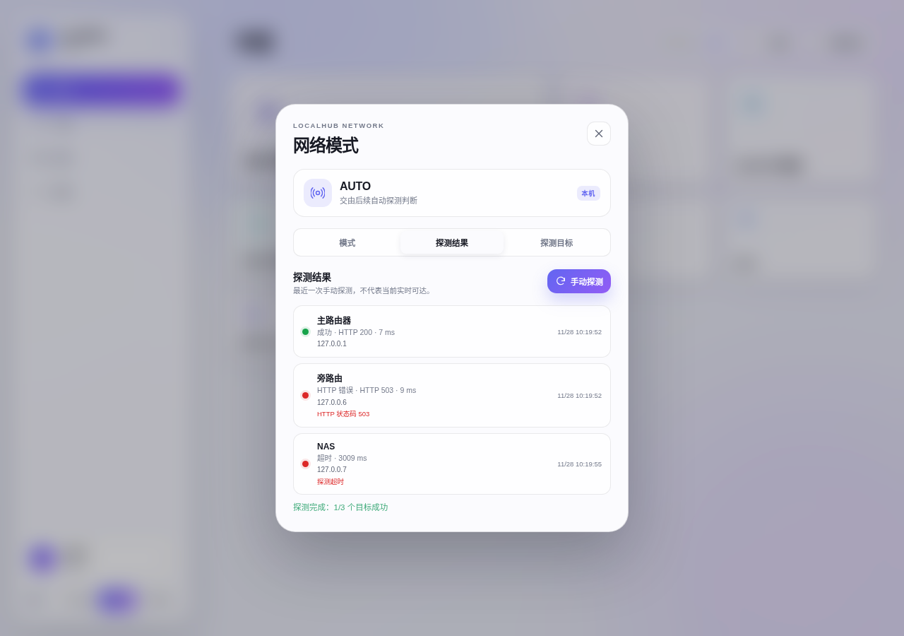

run `probe-01b5f21e0392a9f8`：

```
router  success            http=200
bypass  http_error         http=302  reason=HTTP 状态码 302
nas     connection_failed  reason=HTTP 与 HTTPS 均连接失败
```

302 夹具请求日志只有 `127.0.0.8:80 /`，从未出现 `/final`，证明未跟随重定向。原始响应见 `run-redirect-connection-failed.json`、`fixture-request-log.txt`。

### 4.3 响应体上限与禁用目标

run `probe-bd4d9c8ac22d83d9`：

```
router  success      http=200
bypass  probe_error  http=200  reason=响应体超过限制   （80KiB > 64KiB）
nas     disabled     enabled=false
```

`127.0.0.10` 计数服务器探测后 `/__count=0`，禁用目标没有发起请求。原始响应见 `run-body-limit-disabled.json`。

### 4.4 手动触发运行态与防重复

点击「手动探测」后按钮变「正在探测…」，spinner 与提示可见：

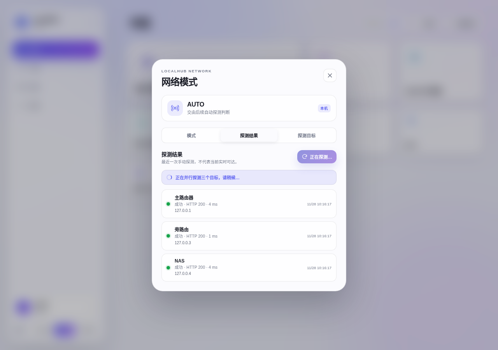

第一次 POST 返回 202；紧接着第二次 POST 返回：

```
HTTP/1.1 409 Conflict
{"error":"probe_in_progress","message":"已有探测正在进行，请等待完成",
 "run_id":"probe-f26e9bb336fba7f3","status":"running"}
```

没有产生第二个 run。原始响应见 `duplicate-first.json`、`duplicate-headers.txt`、`duplicate-second.json`。

### 4.5 持久化与服务重启

同一数据目录停止服务后重启，`/health` 200、schema 8，三份 JSON 逐字一致：

```
diff persist-admin-before.json persist-admin-after.json      (identical)
diff persist-public-before.json persist-public-after.json    (identical)
diff persist-targets-before.json persist-targets-after.json  (identical)
```

重启后 `checked_at` 仍为 `2026-11-28T02:22:07Z` 的原值，没有改写成当前时间；旧 run GET 返回 404 `probe_run_not_found`。流程与原始文件见 `persistence.txt`、`persist-*.json`。

### 4.6 禁用与未探测展示

旁路由、NAS 禁用时显示灰点，不显示失败：

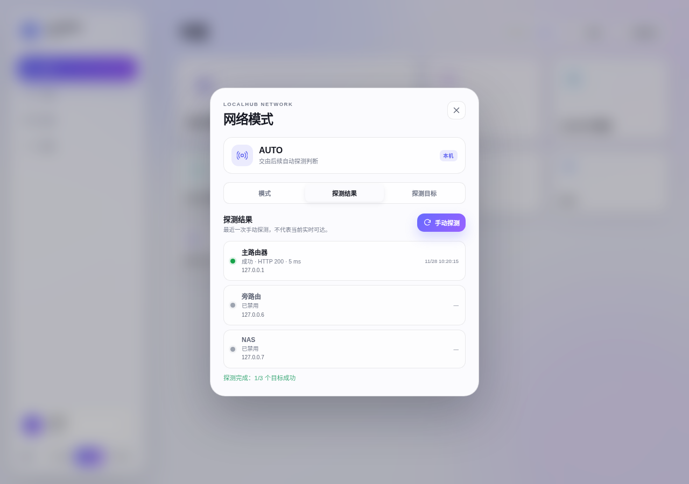

地址修改后主路由显示“未探测”，旧成功不再套用：

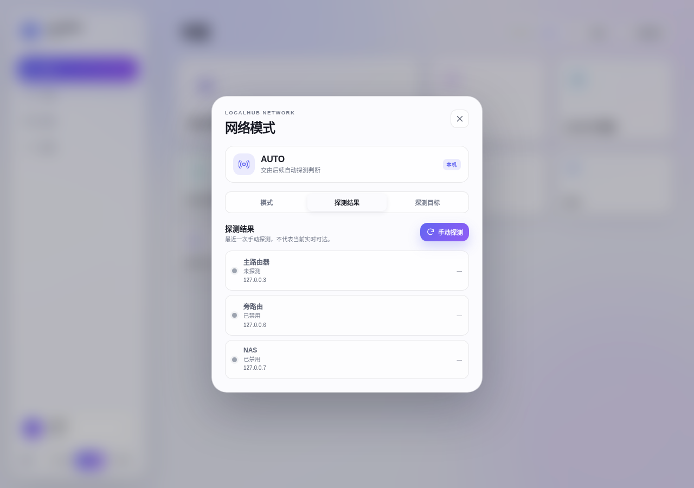

### 4.7 管理员与访客权限

```
访客 GET  /api/admin/network/results -> 401
访客 POST /api/admin/network/probe   -> 401
访客 POST + Origin: http://evil.test -> 403 csrf_rejected
测试管理员 GET  -> 200
测试管理员 POST -> 202
GET /api/network/probe?url=http://evil.test -> 404
PUT 地址 http://evil.test -> 400 invalid_network_config
```

公开响应字段白名单为
`checked_at, enabled, http_status, key, label, latency_ms, status`，
不含 `address`、`failure_reason`。原始请求见 `permission-and-security.txt`、`limits-and-ssrf.txt`。

### 4.8 桌面、移动、三主题

桌面管理员探测目标 tab：

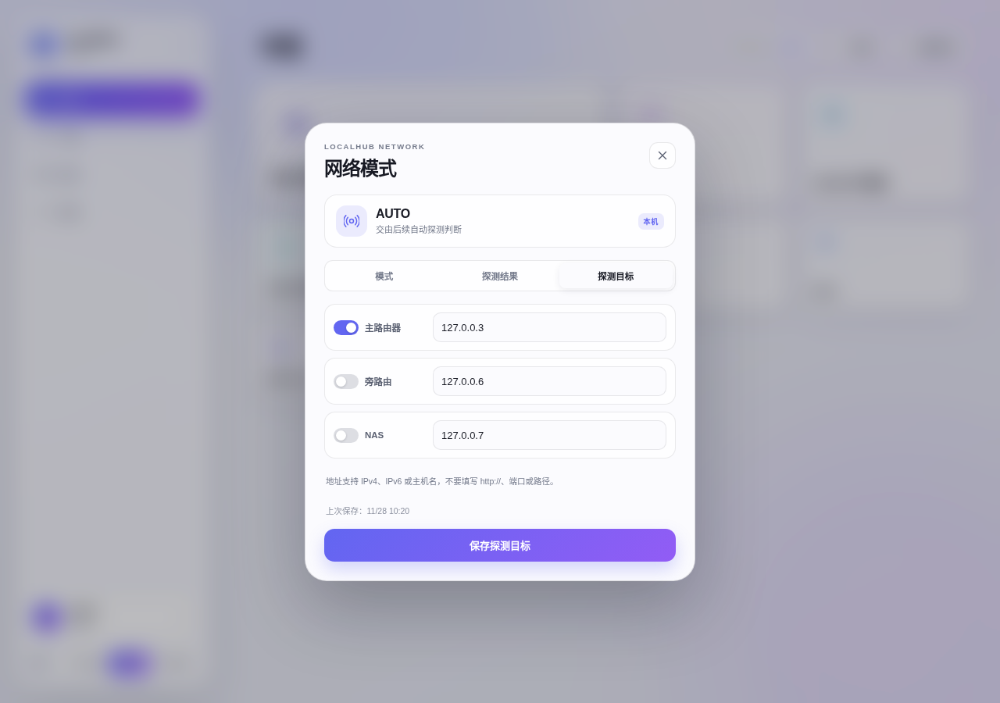

访客桌面只显示模式、脱敏结果和访客说明：

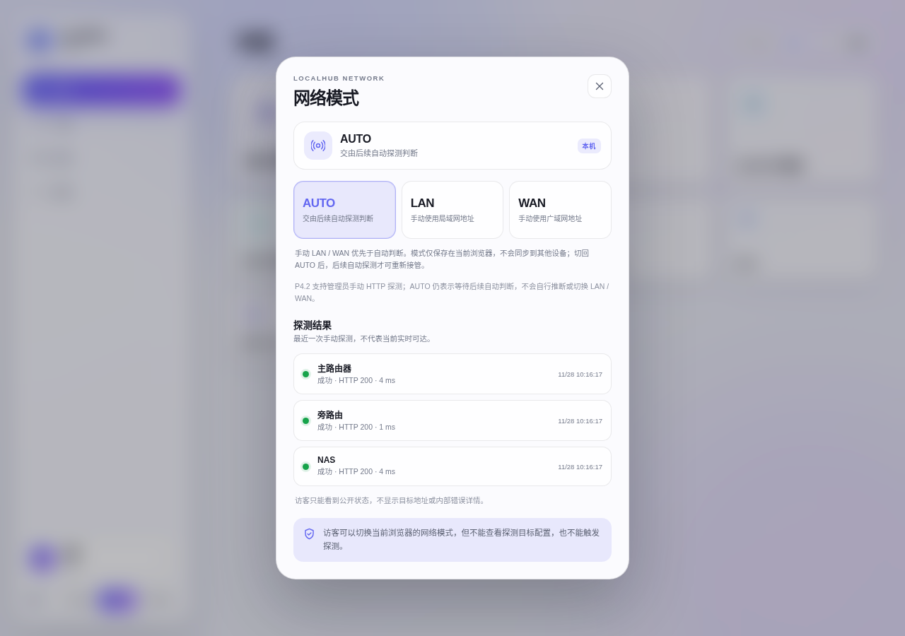

移动 390×844：

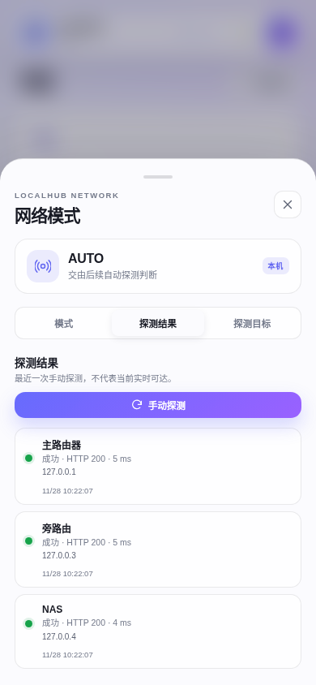

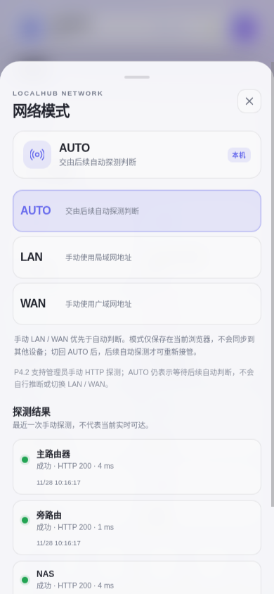

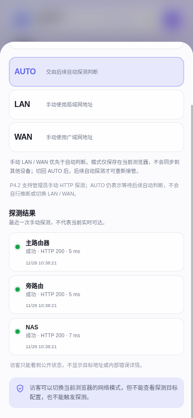

移动端无横向溢出：`innerWidth=390`、`document.scrollWidth=390`、`body.scrollWidth=390`、sheet `scrollWidth=clientWidth=390`。

### 4.9 P3/P4.1 回归

- 首页 9 个书签卡片正常；网络面板关闭后首页恢复。
- 编辑模式工具栏与书签卡片正常，取消可回首页：`regression-edit-mode.png`。
- Spotlight 输入 `jelly` 显示 1 个结果 Jellyfin：`regression-spotlight.png`。
- P4.1 三目标配置、启用/禁用、地址回显正常；手动 LAN/WAN 优先规则未改。
- AUTO 仍为“交由后续自动探测判断”，没有自动 LAN/WAN 判断或切换。

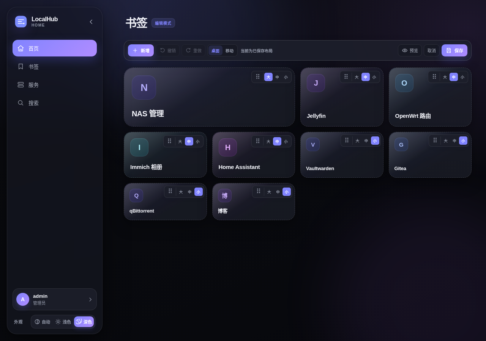


## 5. 自动化测试、CI 与多架构

### 5.1 测试

- `gofmt -l ./cmd ./internal`：无输出。
- `go vet ./...`：exit 0。
- `go test ./... -count=1`：全部包 ok；`go test -json` 计数 **180 run / 180 pass / 0 fail**。
- P4.2 新增 Go 顶层测试 **12 个**：engine 6、store 2、manager 2、approle HTTP 2。
- 前端 `npm test -- --run`：5 个文件、**44 passed / 0 failed**；`probe.test.ts` 新增 5 条。
- 前端 `npm run build`：48 modules，CSS 49.10 kB、JS 198.25 kB，成功。

完整输出见 `test-results.txt`。

### 5.2 本地多架构构建

| 架构 | 文件类型 | 大小 | SHA-256 |
| --- | --- | --- | --- |
| amd64 | ELF x86-64, statically linked, stripped | 10,948,760 bytes | `479064d7179f6ceb7c9442138ce1958ab6245b025870d07dc6f209de387a0a7d` |
| arm64 | ELF ARM aarch64, statically linked, stripped | 10,420,376 bytes | `5d59bdfbf57eed38b24196bd86ec8e1d3d5f059f3fdee9ce7f92a06fcbe210ea` |

命令与输出见 `build-local.txt`。环境无 Docker，QEMU 运行由 CI 完成。

### 5.3 CI 与 T12

- Run `46099506706`：`success`，head `9de96c6...`。
- 前端构建 job `140838501417`：success，14s。
- Go 质量与测试 job `140838501629`：success，39s。
- 多架构镜像与 T12 job `140838665527`：success，6m18s。
- amd64 镜像 `localhub:amd64`：22.3MB，ID `8bb85b1ee972`。
- arm64 镜像 `localhub:arm64`：5.24MB，ID `9c708e46f5bd`。
- arm64 QEMU：`/health` HTTP 200，schema 8，TERM 后 `exit_code=0`。
- T12：**28 PASS / 0 FAIL，RESULT: ALL PASS**；A5 重建后 schema 8、数据仍在。
- Docker Compose 冒烟：`/health` 200；访客 whoami 401、登录 200、退出 200、退出后 401、错误口令 401。

详见 `ci-summary.txt`；CI 证据包 artifact `15244907941`。

## 6. 已知限制与未完成事项

1. **只支持手动探测**：没有定时、后台周期、页面加载自动探测；AUTO 仍等待后续批次判断，不自动切换 LAN/WAN。
2. **未接入书签 URL 选择**：本批禁止修改书签 LAN/WAN URL 逻辑，现有书签行为不变。
3. **真实探测证据使用本地 HTTP 夹具**：三目标分别为 `127.0.0.1/3/4/6/7/8/9/10:80`，验证了真实 socket、超时、302、503、80KiB 与禁用不请求；不是用户真实路由器/NAS 硬件。测试地址未写入仓库。
4. **HTTPS 真实握手未单独实测**：HTTP→HTTPS 回退有单元测试；HTTPS 使用默认证书校验，内网自签证书会失败，本批不扩大为跳过校验。
5. **单次 run 历史仅进程内**：最多 20 条，服务重启后旧 run 404；持久化的只有每目标最新结果，任务书只要求该级别。
6. **保存失败不会单独提示**：`ResultStore.Save` 失败时当前 run 仍显示完成，但最新结果不会更新；正常 SQLite 路径已覆盖测试，未增加额外 UI 错误态。
7. **管理员截图使用本地测试夹具**：5180 仅渲染生产 `dist` 并注入测试管理员会话，产品代码没有登录绕过；测试口令未写入仓库或报告。真实权限由 401/403 与 200/202 的 API 证据覆盖。
8. **移动端为浏览器视口模拟**：390×844 视口验证布局与无溢出，未在实体手机做触摸测试。
9. **未做真实设备网络差异验收**：路由器/NAS 的实际 HTTP 端口、证书、响应策略因用户环境而异；本批只保证标准 HTTP/HTTPS 行为与错误分类。
10. **地址校验是语法与固定目标约束，不是目的地白名单**：管理员可把三个固定目标配置为任意合法内网主机/IP（含回环），这是局域网设备探测的产品前提与管理员信任边界；访客不能配置或触发，服务端也不接受额外 URL。

## 7. 停止状态

P4.2 已完成并提交报告。未启动 P4.3 或 P5，未实现自动判断、定时探测、后台探测或书签 URL 自动切换。等待项目负责人验收；只有负责人验收通过且用户明确说出“下一步”，才允许启动下一批。
