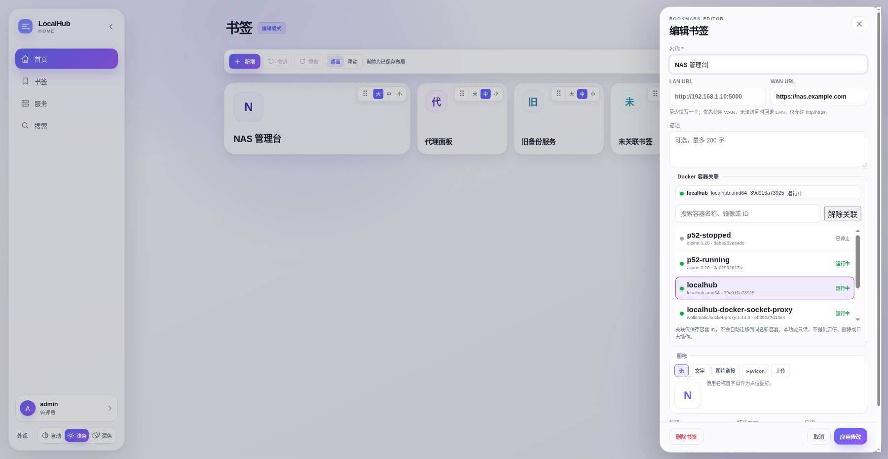
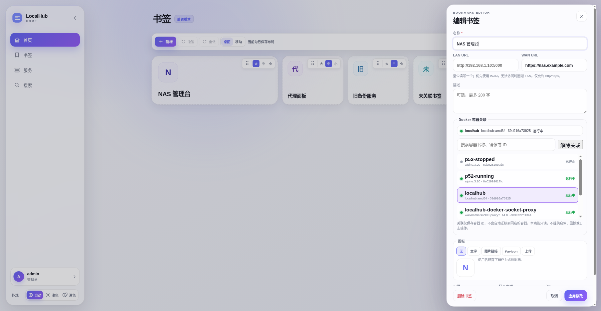
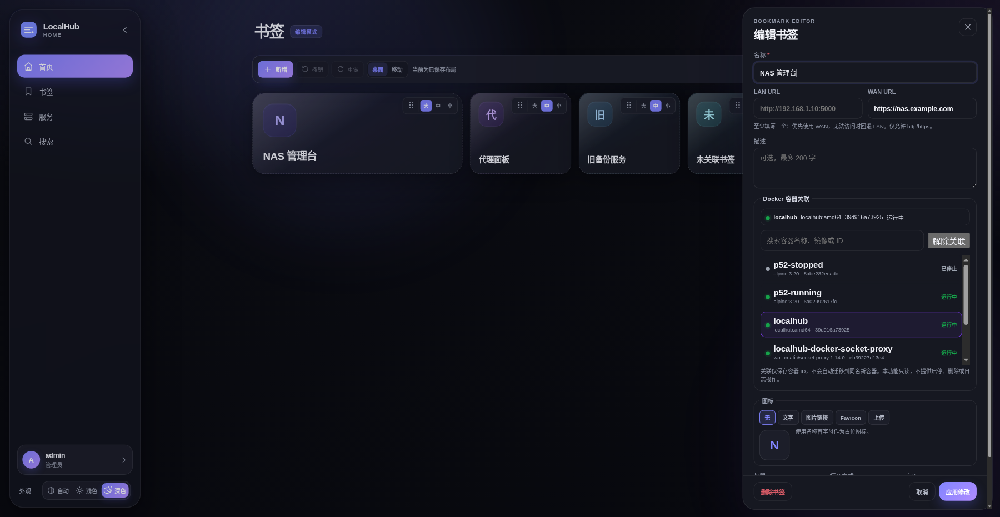
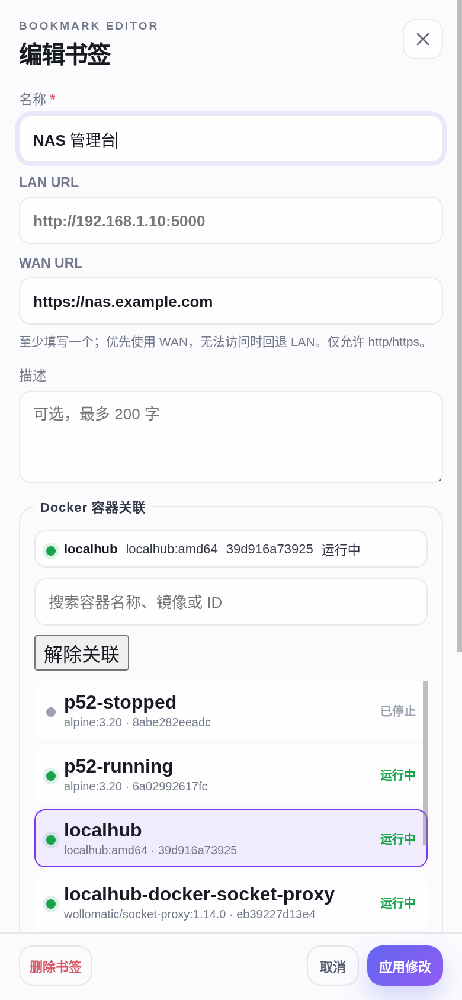
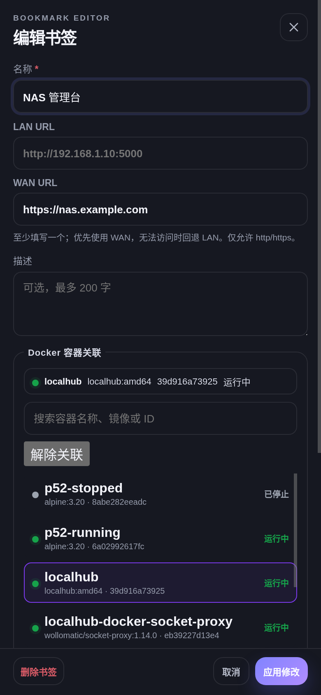
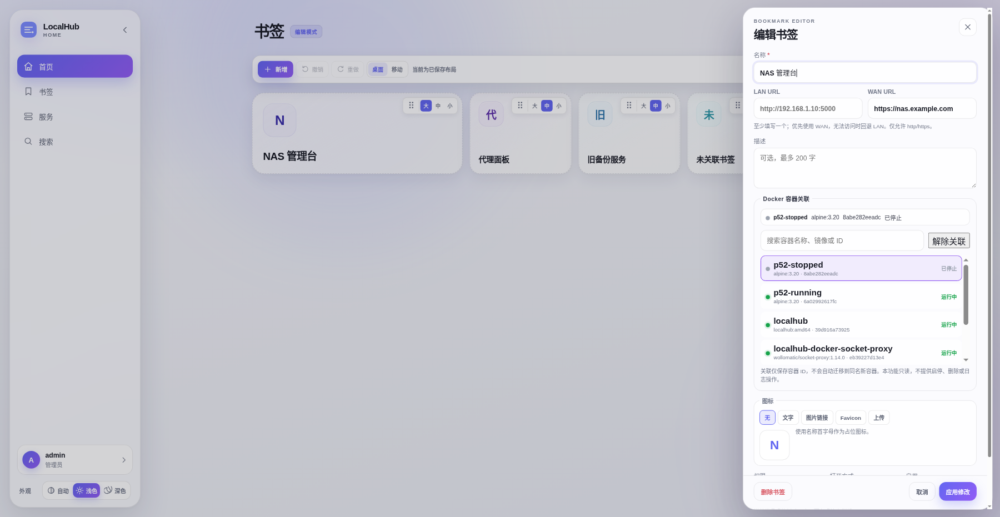
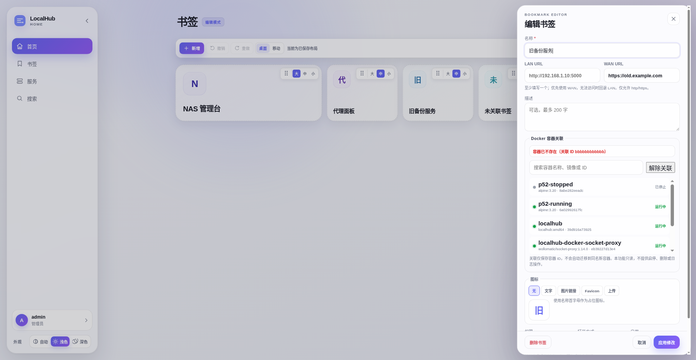
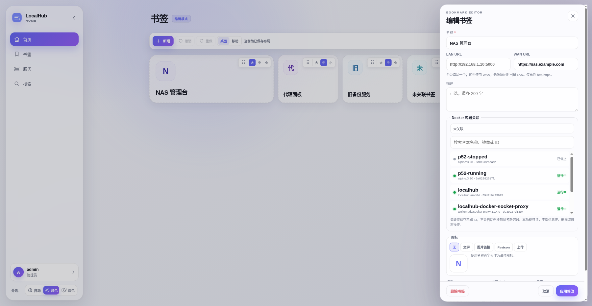
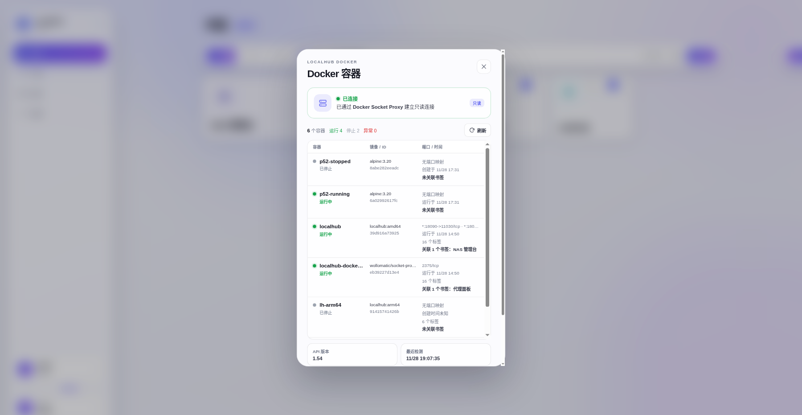
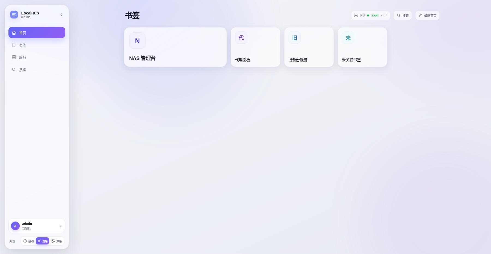

# P5.3 实施报告：书签与 Docker 容器手动关联

- 阶段：P5.3
- 完成日期：2026-11-28
- 功能代码提交：`ab38f5b9d02a0e861fa3286fecec9dc33f5514a7`
- 前置 P5.1：`e483babdad319f968078c07465a857572e321aab`、`b94c4bcc1ca1c0e184f13fa7c52743aa4e93002c`
- 前置 P5.2：`31824fa79926e4a230dc06ede7460c0cd849af59`
- 最终 CI：[46140472869 success](https://github.com/laoXuHome/LocalHub/actions/runs/46140472869)

## 1. 交付摘要

本批实现管理员在书签编辑界面，从 P5.2 已发现的真实 Docker 容器中选择并保存关联。关联只保存稳定容器 ID，一个书签最多一个容器，一个容器可被多个书签关联；不自动匹配、不迁移同名新容器。Docker 页面展示每个容器的关联书签数量和名称。首页、书签打开行为、P4 LAN/WAN 选择和 P5.1 只读边界均未改动。

本批没有任何 Docker 写操作，未增加容器启停、重启、删除、创建、镜像、网络、卷、终端、日志入口。

## 2. 数据模型与容器 ID 规则

复用 P0 迁移 `0003_bookmarks.sql` 中已有的：

```sql
docker_container TEXT NOT NULL DEFAULT ''
```

因此没有新增数据库迁移。

`internal/bookmark/model.go` 对输入统一 trim + lowercase，并新增 `ValidContainerID`：

- 空字符串表示未关联。
- 非空必须是 12–64 位十六进制字符。
- 拒绝容器名称、镜像名、中文、超长字符串。
- 兼容历史 12 位短 ID。
- 容器名称不能作为关联依据。

测试 `TestValidContainerIDRejectsName` 锁定“名称被拒绝”。

## 3. 只读关联视图接口

新增管理员专属：

```text
GET /api/admin/docker/bookmark-links
```

由 `requireAdmin` 保护，访客返回 401。响应：

```json
{
  "status": "connected",
  "checked_at": "…",
  "message": "…",
  "read_only": true,
  "containers": [
    {
      "id": "…",
      "name": "…",
      "status": "running",
      "bookmarks": [{"id": 1, "name": "…"}]
    }
  ],
  "missing": [
    {"bookmark_id": 2, "bookmark_name": "…", "container_id": "…"}
  ],
  "unlinked": 1
}
```

实现要点：

- 读取全部书签，包括禁用书签。
- 调用 P5.1 只读 `ListContainers`。
- 仅按容器 ID 精确匹配；同名不同 ID 不关联。
- 只有 Docker `status=connected` 时才计算 `missing`。
- Docker 故障、超时或权限不足时，`containers=[]`、`missing=[]`，已有书签关联字段保持不变，不误判“容器已不存在”。
- 数据库不可用返回 503；Docker 不可用仍返回 200 状态对象。
- 容器名称、镜像、Labels 等外部数据只作为普通文本输出，不拼接 HTML。

测试 `TestDockerBookmarkLinksAdminMissingAndOutage` 覆盖：管理员 200、访客 401、一个正常关联、一个 missing、Docker 关闭后 missing 为空。测试扩展为两个容器后，修复并锁住了“切片扩容导致指针失效”的实现缺陷。

## 4. 书签编辑界面

`web/src/components/BookmarkDrawer.tsx` 打开抽屉时调用 P5.2 `loadDockerContainers`，只展示真实返回的容器。

当前关联展示：

- 未关联：显示“未关联”。
- 运行中 / 已停止 / 异常 / 未知：显示状态点和状态文字，颜色沿用 P5.2。
- 容器已不存在：显示红色“容器已不存在（关联 ID …）”。
- Docker 暂不可用：显示“Docker 暂不可用，无法确认容器是否仍然存在；当前关联不会被自动移除。”
- 容器列表读取失败：显示读取失败，不提供任何虚构容器。

选择器：

- 搜索容器名称、镜像和容器 ID。
- 最多展示前 50 个，列表可滚动。
- 点击“解除关联”清空当前选择。
- 保存时随书签 PUT 写入 `docker_container`。
- 不自动选择、不自动绑定。

访客不显示“编辑首页”入口，也不能调用保存接口；后端仍执行管理员校验。

## 5. Docker 页面

`web/src/components/DockerSheet.tsx` 刷新时并行请求连接状态、容器列表和关联视图；关联视图失败时保留上一次成功数据。

每个容器行新增：

- 有书签：`关联 N 个书签：名称…`
- 无书签：`未关联书签`
- 超过两个名称折叠为“等 N 个”，完整名称在 `title`。

容器行没有新增任何操作按钮。

## 6. 样式与主题

`web/src/style.css` 新增：

- `.docker-link-fieldset`
- `.docker-link-current`
- `.docker-link-list`
- `.docker-link-option`
- `.docker-container-links`

修复抽屉内“解除关联”按钮被挤出视口：为 fieldset、controls、list 增加 `min-width:0`，搜索框改为 `flex:1 1 0; width:100%`。移动端关联列表单列。

状态色：

| 状态 | 颜色 |
|---|---|
| 运行中 | `#16A34A` |
| 已停止 | `#9CA3AF` |
| 异常 | `#DC2626` |
| 未知 | `#6B7280` |
| 容器已不存在 | 红字 `#DC2626` |

桌面、移动端和 AUTO/LIGHT/DARK 三主题截图均在 `docs/p5.3/browser/`。

## 7. 验证结果

### 7.1 本地自动化

| 检查 | 结果 | 证据 |
|---|---|---|
| `go test ./...` | 全部包通过 | `local/go-test.log` |
| `go vet ./...` | 通过 | `local/go-vet.txt` |
| 前端单元测试 | 7 个文件、78 个测试通过 | `local/frontend-test.log` |
| `npx tsc --noEmit` | 通过 | `local/tsc.txt` |
| 前端生产构建 | 通过，CSS 60.84 kB、JS 220.92 kB | `local/frontend-build.log` |
| 本地访客接口 | 401 `需要管理员登录` | `local/guest-401.txt` |

### 7.2 CI 真实 Docker

CI 使用真实 Docker Socket、真实容器和 Compose 重启执行 `scripts/p53-ci.py`。最终运行全部阶段 PASS：

```text
setup
persistence
status change
outage keeps associations
recovery
removed and same-name new ID
```

真实 fixture 计数：

```json
{"total": 6, "running": 4, "stopped": 2, "error": 0, "unknown": 0}
```

| 阶段 | 真实结果 | 证据 |
|---|---|---|
| setup | p52-running 关联 2 个书签；p52-stopped 关联 1 个；missing 1 个；unlinked 1 个 | `ci/links-setup.json` |
| changed | 将一个书签从 running 容器改到 stopped 容器；原容器只剩 1 个关联 | `ci/links-changed.json` |
| after-restart | Compose 重启后关联数量与容器 ID 不变 | `ci/links-after-restart.json` |
| container-stopped | `docker stop` 后 p52-running 状态变 `stopped`，关联仍在 | `ci/links-container-stopped.json` |
| container-restarted | `docker start` 后恢复 `running`，关联仍在 | `ci/links-container-restarted.json` |
| outage | 停 Socket Proxy 后 `status=connection_failed`、`containers=[]`、`missing=[]`，书签关联字段不变 | `ci/links-outage.json` |
| recovered | Proxy 恢复后 `connected`，关联仍在 | `ci/links-recovered.json` |
| removed | 删除容器后出现 missing，旧 ID 被记录 | `ci/links-container-removed.json` |
| same-name new ID | 新建同名容器后，旧关联仍指向旧 ID；新容器 `bookmarks=[]` | `ci/links-same-name-new-id.json`、`ci/same-name-old-new-ids.txt` |

同名不同 ID 的真实结果：

```text
old=c70892a2a83909b3be71fbc7d39f55515fca79715db4f10dda350babe1c4dc49
new=c12a42498d3a5f3aeef6d2fd69b861072cf4eb153329d4d95999f52f020b0c2e
```

权限证据 `ci/permission-check.txt`：guest 401、admin 200、`read_only=true`。

### 7.3 V-02 与部署健康

| 检查 | 结果 | 证据 |
|---|---|---|
| V-02 只读边界回归 | 15 PASS / 0 FAIL；Socket Proxy allowlist 未改 | `ci/p51-v02.log` |
| Compose 健康 | 通过 | `ci/health-compose.json` |
| amd64 / arm64 镜像 | 构建通过 | `ci/version-amd64.txt`、`ci/version-arm64.txt` |
| T12 / arm64 QEMU | CI success | `ci/CI-run.txt` |

### 7.4 本地 UI 截图口径

本机没有 Docker CLI/权限，截图数据来自 P5.2 CI 保存的真实 `/containers/json` 响应回放，不是本机实时 Docker。截图只证明前端渲染与交互；真实 Docker 行为以上一节 CI 为准。详见 `local/replay-disclaimer.md`。

## 8. 验收对照

| # | 验收项 | 结果 | 证据 |
|---|---|---|---|
| 1 | 管理员建立关联 | 通过 | `ci/links-setup.json` |
| 2 | 更换、解除关联 | 通过 | `ci/links-changed.json`、`ci/links-unlinked.json` |
| 3 | 一个书签不能关联多个容器 | 通过 | 单字段 `docker_container`；接口按单值匹配 |
| 4 | 多个书签关联同一容器 | 通过 | `ci/links-setup.json` 中 p52-running 有 2 个书签 |
| 5 | 重启后关联仍在 | 通过 | `ci/links-after-restart.json` |
| 6 | 状态变化后更新 | 通过 | `ci/links-container-stopped.json`、`ci/links-container-restarted.json` |
| 7 | 停止/异常/未知正确区分 | 停止真实覆盖；异常/未知由 P5.2 单元测试覆盖 | `ci/links-container-stopped.json` |
| 8 | 删除后显示不存在且不误报连接失败 | 通过 | `ci/links-container-removed.json` |
| 9 | Docker 不可用不误删、不判不存在 | 通过 | `ci/links-outage.json`、`ci/links-recovered.json` |
| 10 | 同名不同 ID 不接管旧关联 | 通过 | `ci/links-same-name-new-id.json` |
| 11 | 访客不能建立/修改/解除 | 通过 | `ci/permission-check.txt`、`local/guest-401.txt` |
| 12 | Docker 页显示数量和名称 | 通过 | `browser/desktop-light-docker-links.png`、`ci/links-setup.json` |
| 13 | 首页布局与打开行为不变 | 通过 | `browser/desktop-light-home.png`；首页无 Docker 元素 |
| 14 | P5.1 只读边界有效，V-02 通过 | 通过 | `ci/p51-v02.log` |
| 15 | Docker 不可用时其他模块正常 | 通过 | `ci/p51-outage.log` |
| 16 | Go/前端/类型/构建/AMD64/Compose 健康 | 通过 | `ci/CI-run.txt`、`local/` 测试日志 |

## 9. 界面证据

### 桌面三主题：已关联且运行中







### 移动端





### 已停止、容器不存在、解除关联







### Docker 页面关联书签



### 首页回归



## 10. 已知限制与未完成事项

1. 本机无 Docker 权限，真实 Docker 生命周期验证只在 CI；本地截图是真实 API 响应回放，不是实时 Docker。
2. 真实 fixture 只出现 `running` 和 `stopped`；`error` 与 `unknown` 由 P5.2 单元测试和状态映射覆盖，没有真实 error/unknown 容器截图。
3. 书签管理列表卡片本身没有 missing 徽标；“容器已不存在”在编辑抽屉内识别并可解除。任务要求未指定卡片层级。
4. 关联视图读取包括禁用书签，因此 Docker 页可能显示禁用书签名称；这是为管理员完整识别关联而保留的行为。
5. 本批不做自动匹配，不提供批量关联，不提供容器操作。
6. 未进入 P5.4。

## 11. 停止

P5.3 功能、测试、CI、报告和证据已完成。按任务要求停止，不进入 P5.4，等待项目负责人验收。
