# P5.4 实施报告：Docker 集成最终整合与验收

- 阶段：P5.4，P5 最后一批
- 日期：2026-11-28
- 功能与 CI 提交：`af22334f213bf6fef8b8305acd30942606028cfb`
- 最终 CI：[46146740489 success](https://github.com/laoXuHome/LocalHub/actions/runs/46146740489)

## 结论

**P5 阶段达到关闭条件。**

P5.1 只读连接、P5.2 容器发现与状态展示、P5.3 书签手动关联在真实 Docker 与真实 Compose 中协同正常；Docker 故障不会影响首页、书签、登录和其他模块；V-02 再次 15 PASS / 0 FAIL；P1–P4 核心回归通过；没有影响本批目标的阻塞问题。

P5.4 没有新增任何 Docker 写操作、自动匹配、P6 功能或产品运行时行为。代码变更仅为新增 P5.4 的 AMD64 集成验收 CI Job 与回归脚本。

## 1. 施工范围核对

| 范围 | 结果 |
|---|---|
| 只通过 Socket Proxy 访问 Docker API | 保持；Compose 仅 Proxy 挂载 Socket |
| LocalHub 不直接挂载 Socket | 保持；LocalHub 服务无 Socket volume |
| Socket Proxy 只读最小权限 | 未修改 allowlist |
| Docker 写操作全部拒绝 | V-02 15 PASS / 0 FAIL |
| 容器发现与四态展示 | running/stopped/error 真实通过；unknown 单元测试 |
| 书签手动关联 | 建立、更换、解除、重启持久化、missing、同名不同 ID 通过 |
| Docker 页面关联数量与名称 | 通过 |
| 首页与 P4 LAN/WAN | 未修改；回归通过 |
| P6 备份恢复 | 未开始 |

## 2. P5.1–P5.3 整体检查

完整逐项记录见 [`checks/p5-overall.md`](p5.4/checks/p5-overall.md)。

| 阶段 | 核心能力 | 整体检查结果 |
|---|---|---|
| P5.1 | Socket Proxy、只读连接、状态与错误提示 | 通过；V-02 15/0；故障时其他模块 200 |
| P5.2 | 真实容器发现、字段、四态、刷新 | 通过；真实 running/stopped/error；故障不误报停止 |
| P5.3 | 书签关联、ID 识别、missing、Docker 页展示 | 通过；建立/修改/解除/重启/删除/同名均通过 |
| P5.4 | 三部分协同、P1–P4 回归、最终验收 | 通过；最终 CI success |

## 3. 真实 Docker 与模拟测试的分界

**真实 Docker / 真实 Compose（CI）**

- 真实容器：`p52-running`、`p52-stopped`、`p54-restarting`。
- 真实 Socket Proxy、真实 Compose 重启、真实 stop/start/rm、真实同名新 ID。
- 真实 V-02 写拒绝。
- 证据：`ci/p54/`、`ci/p53/`、`ci/p51-v02.log`。

**模拟 / 单元测试（本地）**

- 本机无 Docker CLI/权限。
- P5.4 浏览器截图使用本地测试 HTTP 服务返回固定 4 个容器；不是真实 Docker。
- `unknown` 状态未在真实 Docker 中构造；由 Go `containerStatus` 和前端 `containerStatusTone/Label` 单元测试覆盖。
- 本地截图只证明 UI 渲染、搜索、主题和响应式布局。
- 说明：`local/simulated-ui.md`、`local/ui-checks.md`。

## 4. 最终 CI

运行：[46146740489](https://github.com/laoXuHome/LocalHub/actions/runs/46146740489)，提交 `af22334f213bf6fef8b8305acd30942606028cfb`，总耗时约 3 分钟，结论 success。

| Job | 结果 | 链接 |
|---|---|---|
| 前端构建 | success | [job 140984340222](https://github.com/laoXuHome/LocalHub/actions/runs/46146740489/job/140984340222) |
| Go 质量与测试 | success | [job 140984340482](https://github.com/laoXuHome/LocalHub/actions/runs/46146740489/job/140984340482) |
| P5.4 AMD64 集成验收 | success | [job 140984515477](https://github.com/laoXuHome/LocalHub/actions/runs/46146740489/job/140984515477) |
| 多架构镜像与 T12 验证 | success | [job 140984515558](https://github.com/laoXuHome/LocalHub/actions/runs/46146740489/job/140984515558) |

Artifacts：

- `p54-verification-af22334f213bf6fef8b8305acd30942606028cfb`（artifact 15263747282）
- `verification-af22334f213bf6fef8b8305acd30942606028cfb`（artifact 15264111731）
- 下载页：https://github.com/laoXuHome/LocalHub/actions/runs/46146740489#artifacts

P5.4 验收 Job 只构建 AMD64；ARM64/QEMU 由独立 Job 运行，不作为 P5.4 验收前提。两者最终均 success。

## 5. Docker 正常、故障、恢复

完整记录见 [`checks/docker-lifecycle.md`](p5.4/checks/docker-lifecycle.md)。

### 正常

- `/api/admin/docker/status` → `connected`，`read_only=true`。
- 容器列表 `status=connected`。
- 真实计数：`total=6, running=4, stopped=1, error=1, unknown=0`。
- `p52-running` 下 2 个关联书签，`p52-stopped` 下 1 个。

### 状态变化

- `docker stop p52-running` → 关联状态 `stopped`，关联仍在。
- `docker start p52-running` → 恢复 `running`，关联仍在。

### 删除与同名不同 ID

- 删除 `p52-stopped` 后 `missing` 出现，Docker 状态仍 `connected`。
- 新建同名容器，ID 改变：

```text
old=901133423d14b0eb4e7c2073e44cc5743f039d778ce00a869bd5c463606b6b78
new=48c24434aba408d49be9d452c328872b3fd85fed88db3ff58c940ebd9f2751d9
```

- 新容器 `bookmarks=[]`；旧关联仍 missing 到旧 ID，没有被新容器接管。

### 故障

停止 Socket Proxy 后：

```json
{
  "docker_status": "connection_failed",
  "containers": 0,
  "missing": 0,
  "associations_kept": true,
  "public_bookmarks": 200,
  "auth_status": 200,
  "health": 200
}
```

- 未把连接故障误报为“全部停止”。
- 未把连接故障误判为“容器不存在”。
- 未删除或改写既有书签关联。
- 首页、书签、登录仍正常。

### 恢复

Proxy 重启后恢复 `connected`，容器列表和关联恢复。

## 6. 容器四态与关联状态

完整记录见 [`checks/four-states-and-links.md`](p5.4/checks/four-states-and-links.md)。

| 状态 | 真实容器 | 结果 | 颜色 |
|---|---|---|---|
| running | `p52-running` | 运行中；2 个书签 | `#16A34A` |
| stopped | `p52-stopped` | 已停止；1 个书签 | `#9CA3AF` |
| error | `p54-restarting` | 异常；无关联 | `#DC2626` |
| unknown | 未真实构造 | 单元测试 + 本地模拟 UI | `#6B7280` |

CI 真实计数：

```json
{"total": 6, "running": 4, "stopped": 1, "error": 1, "unknown": 0}
```

四态颜色与既定标准一致。`p54-restarting` 使用 `--restart=always` 进入 restarting，LocalHub 真实映射为 `error`。

关联状态：

- 未关联：`docker_container=''`，`unlinked` 计数。
- 已关联运行中：p52-running 2 个书签。
- 已关联停止：p52-stopped 1 个。
- 已关联异常：p54-restarting 状态 error。
- 已关联未知：本地模拟容器；真实环境未构造。
- 已关联不存在：missing，红色“容器已不存在”。
- Docker 故障：missing=[]，关联保留。

## 7. P1–P4 回归

完整记录见 [`checks/p1-p4-regression.md`](p5.4/checks/p1-p4-regression.md)。

| 模块 | 结果 | 证据 |
|---|---|---|
| P1 权限 | 访客 401、登录 200、退出 401、错误密码 401 | `ci/p54/p1-auth.json`、`ci/auth-smoke.txt` |
| P2 书签 | 创建 201、详情/更新 200、公开可见、删除 200 | `ci/p54/p2-p3-bookmarks-layout.json` |
| P2 图标 | 上传/读取/重启后读取/SSRF 502/删除清理通过 | `ci/icon-smoke.txt` |
| P2 导入导出 | 预览不写库、执行 created=1、JSON/HTML 导出、访客 401 | `ci/transfer-smoke.txt` |
| P3 首页 | 布局读取/保存 200；访客首页无 Docker 元素 | `p2-p3-bookmarks-layout.json`、截图 |
| P4 网络 | 3 个目标读取/保存 200；公开目标/状态 200；LAN/WAN 保留 | `ci/p54/p4-network.json` |

隔离 CI 中公开网络状态为 `unknown`，因没有可达探测目标；这是 P4 探测结果的正常表现，不改变 P4.1–P4.4 既有语义。LAN/WAN 地址选择数据源和前端测试未变。

## 8. 界面证据

### Docker 页面四态：浅色、深色、AUTO


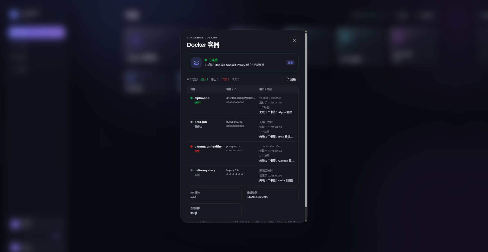

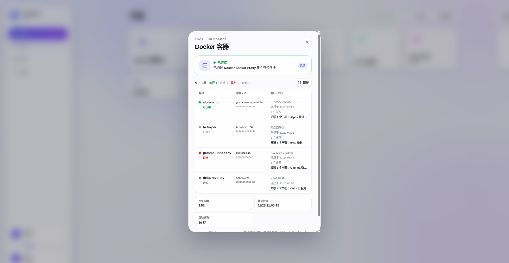

### 移动端 Docker 页面

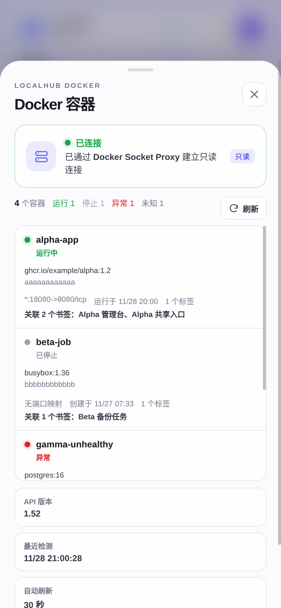

### 编辑抽屉：异常、未知、缺失

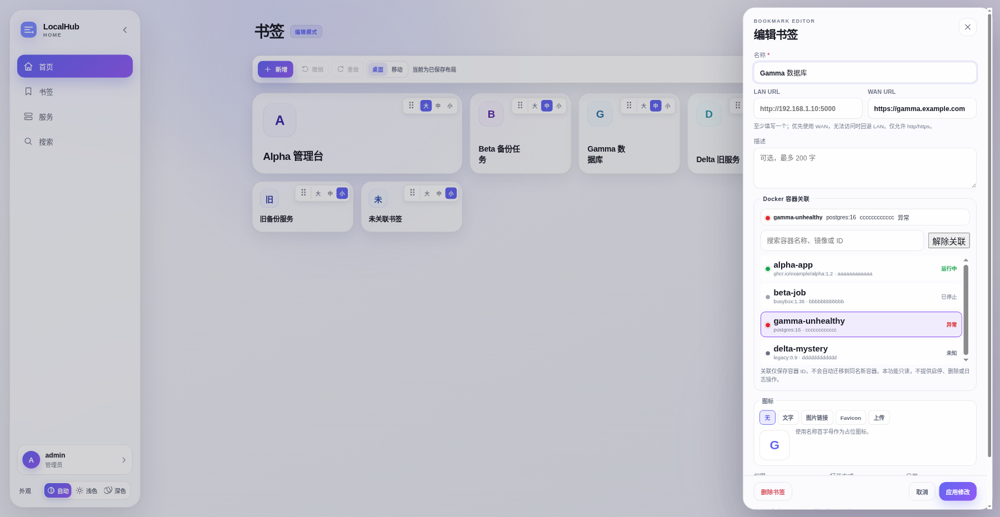

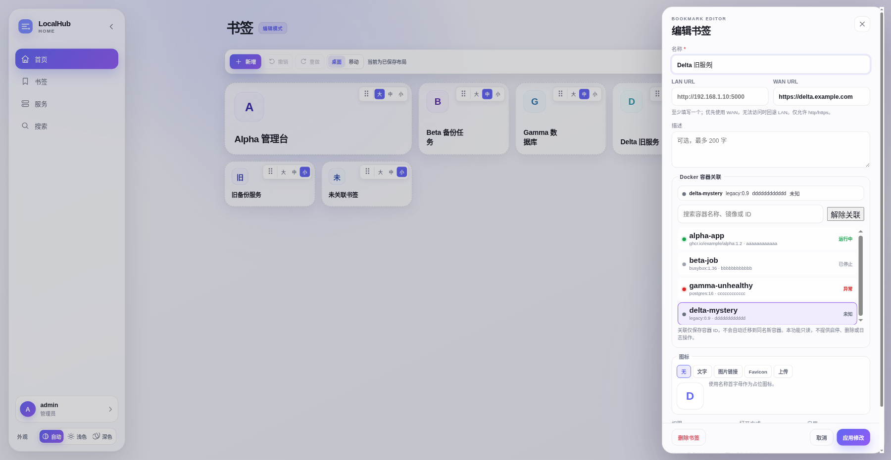

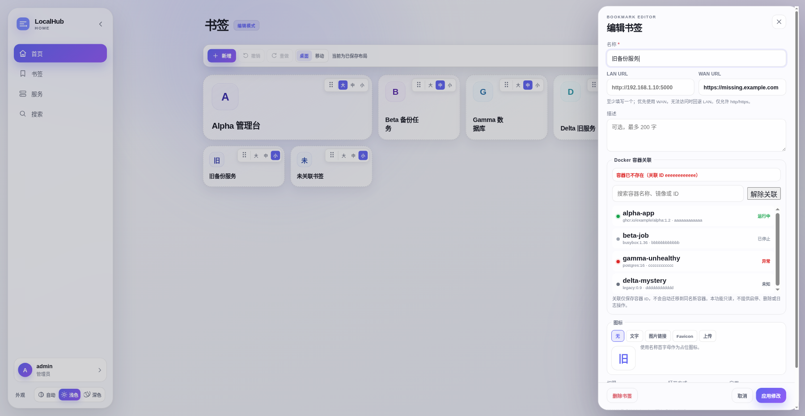

### 移动端编辑抽屉

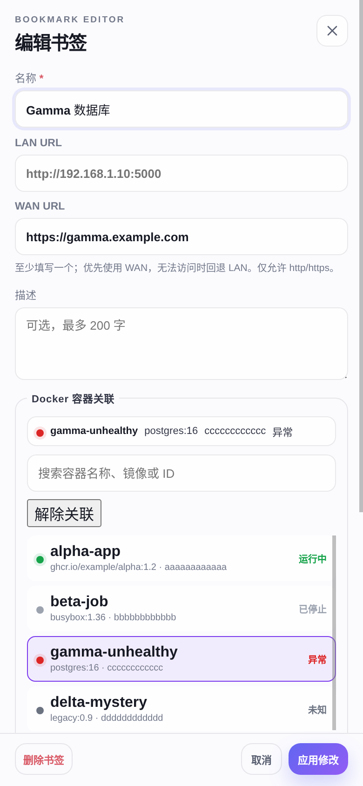

### Docker 故障页面

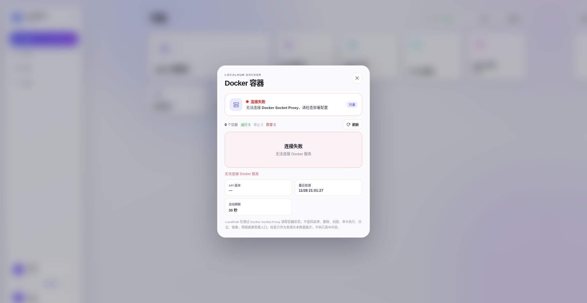

### 访客首页：无 Docker 元素

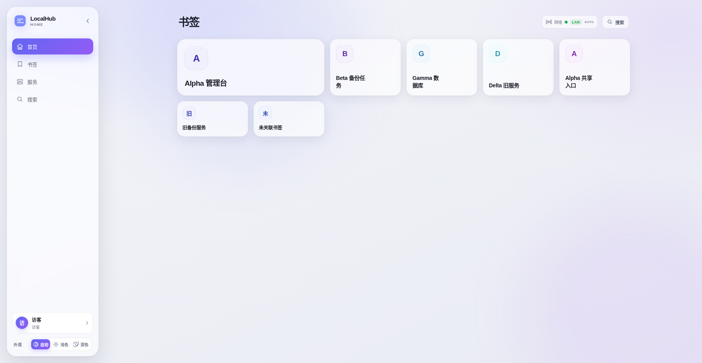

### P5.3 最终主题回归截图

P5.4 未修改产品 UI；以下为 P5.3 最终构建截图，用于确认三主题和移动端没有回归。

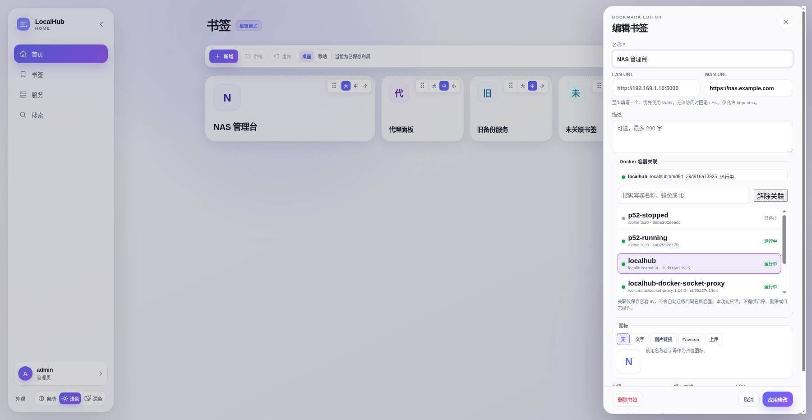

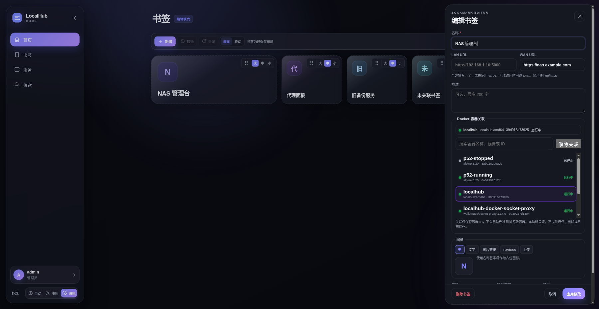

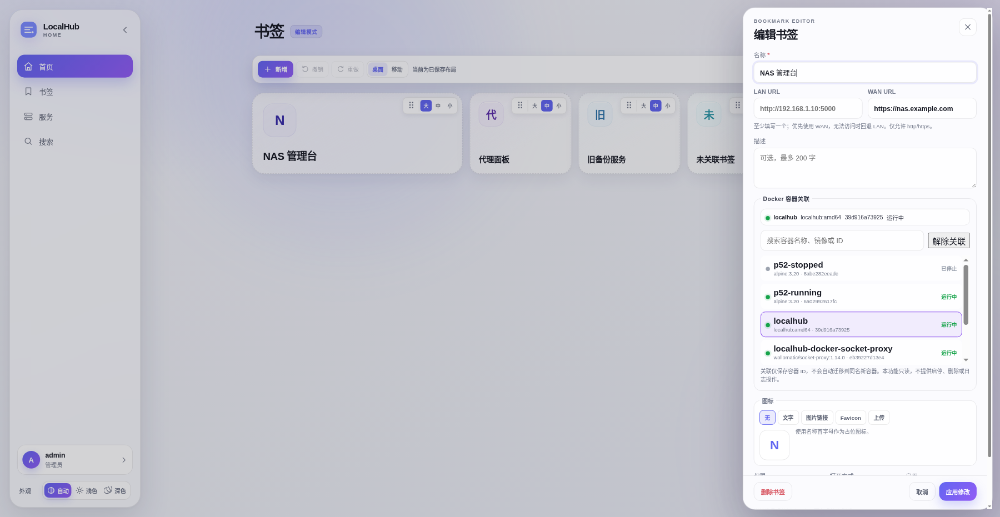

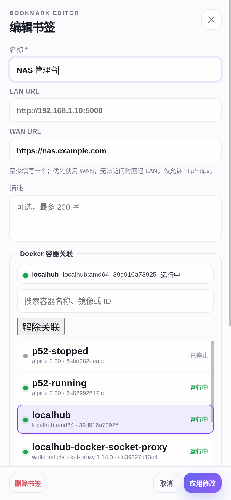

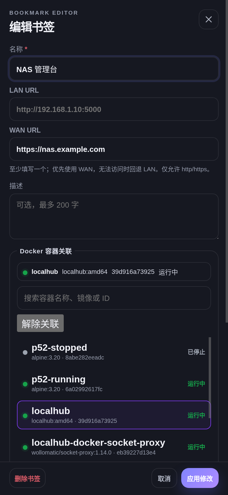

## 9. 只读安全边界 V-02

- 结果：`pass=15 fail=0`。
- 11 个写请求全部 405：create/start/stop/restart/delete/exec、镜像删除、网络创建/连接、versioned start/image delete。
- 读 allowlist：`/version`、`/containers/json` 200；`/images/json`、容器日志 403。
- Socket Proxy allowlist 未改；LocalHub 无 Socket 挂载。
- 完整矩阵：`ci/p51-v02/v02-matrix.txt`、`ci/p51-v02.log`。

## 10. 验收对照

| # | 验收项 | 结果 | 证据 |
|---|---|---|---|
| 1 | Proxy 正常时发现与关联正常 | 通过 | `ci/p54/p5-docker-four-states-real.json`、`ci/p53/links-setup.json` |
| 2 | Proxy 停止时显示连接故障 | 通过 | `ci/p54/p5.4-outage.json`、`browser/desktop-light-docker-outage-simulated.png` |
| 3 | 恢复后容器与关联恢复 | 通过 | `ci/p53/links-recovered.json` |
| 4 | 故障不影响首页、书签、登录 | 通过 | `p5.4-outage.json`（health/bookmarks/auth 200） |
| 5 | running/stopped/error/unknown 四态 | running/stopped/error 真实；unknown 单元/模拟 | `p5-docker-four-states-real.json`、`local/` |
| 6 | missing 与故障明确区分 | 通过 | `links-container-removed.json`、`links-outage.json` |
| 7 | 同名不同 ID 不接管旧关联 | 通过 | `links-same-name-new-id.json` |
| 8 | 关联重启后仍存在 | 通过 | `links-after-restart.json` |
| 9 | 访客不能执行管理员操作 | 通过 | `permission-check.txt`、`p1-auth.json` |
| 10 | V-02 再次 15 PASS / 0 FAIL | 通过 | `ci/p51-v02.log` |
| 11 | Go/前端/类型/构建 | 通过 | CI Go、前端 Job；`local/` |
| 12 | AMD64 构建、核心验证、Compose 健康 | 通过 | P5.4 Job、`ci/health-compose.json` |
| 13 | P1–P4 核心回归 | 通过 | `checks/p1-p4-regression.md` |
| 14 | 无影响本批目标的阻塞问题 | 通过 | 本报告第 11 节 |

## 11. 已知限制

1. 真实 Docker 未构造 `unknown` 容器；该状态由 Go/前端单元测试和本地模拟 UI 覆盖。真实 CI 已覆盖 `running`、`stopped`、`error`。
2. 本机无 Docker CLI/权限，P5.4 浏览器截图使用固定测试 HTTP 服务模拟 Docker，不是真实 Docker 页面；真实数据、生命周期和关联以 CI 证据为准。
3. 隔离 CI 中 P4 公开网络状态为 `unknown`，因无可达探测目标；P4 目标配置、LAN/WAN 数据源和既有测试未变。
4. 未在真实 Docker 中制造 unhealthy 容器；`error` 由 restarting 容器真实覆盖，`unhealthy → error` 由 P5.2 单元测试覆盖。
5. P5.4 不新增产品功能；没有容器启停、镜像/网络/卷/终端/日志入口。
6. 未进入 P6。

以上限制均不构成 P5 关闭阻塞。

## 12. P5 阶段最终交付

| 阶段 | 功能代码 | 文档/证据 | 最终 CI |
|---|---|---|---|
| P5.1 | `e483babdad319f968078c07465a857572e321aab` | `docs/p5.1-report.md`、`docs/p5.1/` | 已通过 |
| P5.2 | `31824fa79926e4a230dc06ede7460c0cd849af59` | `docs/p5.2-report.md`、`docs/p5.2/` | 46132159579 |
| P5.3 | `ab38f5b9d02a0e861fa3286fecec9dc33f5514a7` | `docs/p5.3-report.md`、`docs/p5.3/` | 46140472869 |
| P5.4 | `af22334f213bf6fef8b8305acd30942606028cfb` | 本报告、`docs/p5.4/` | 46146740489 |

P5 阶段关闭条件：

- Docker 只读边界有效，写操作全部拒绝。
- 容器发现、四态、故障/恢复、刷新行为正常。
- 书签关联完整，按稳定 ID 识别，不自动迁移。
- Docker 故障不影响其他模块。
- P1–P4 回归通过。
- AMD64 构建与 Compose 健康通过。
- 无阻塞问题。

## 13. 停止

P5.4 已完成，P5 阶段正式关闭。按任务要求立即停止，不进入 P6，不开始备份恢复；等待项目负责人验收和新的“下一步”指令。
